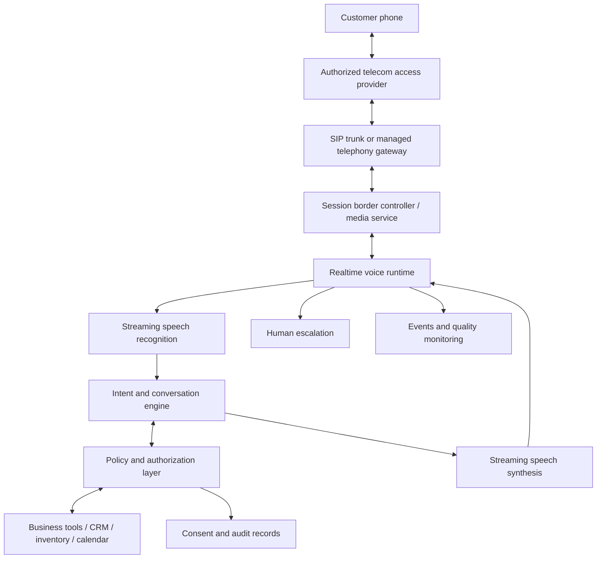
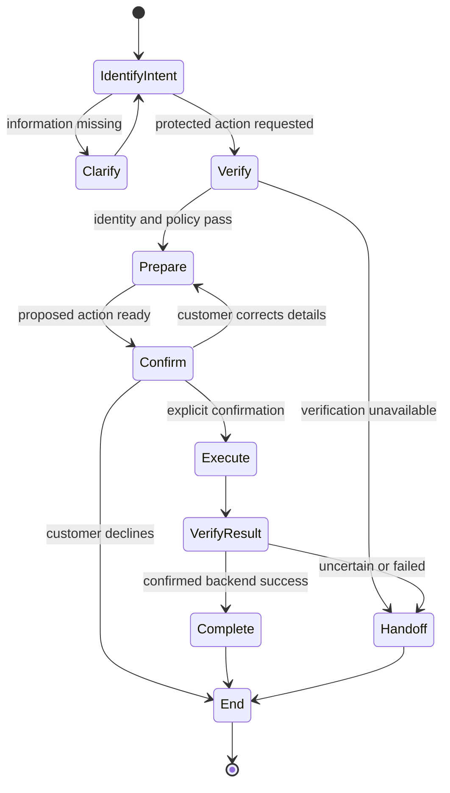
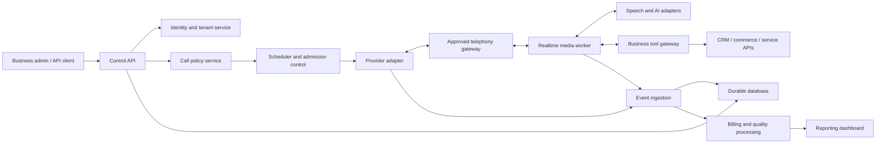

# AI Telecalling in India: The Complete Guide to Voice AI, SIP Trunking, Telecom Infrastructure and Autonomous Business Communication

*From the telephone network to the intelligence that understands a customer, takes authorized action and follows through.*

**By Vaiket Team | Research and engineering guide | Research cutoff: November 25, 2026**

Imagine a customer calling a business at nine in the evening. They do not want to hear a long menu. They want to know whether their order will arrive tomorrow, whether they can change the delivery address, or whether a person is available to explain a service in their own language. The customer may speak Hindi, English, Bengali, Tamil or a mixture of languages. They may be walking through a noisy market or using a low-cost handset on a congested mobile network. They may change their mind halfway through an explanation.

A useful voice agent must cope with that reality. It has to receive the call, interpret speech, determine what the customer intends, look up accurate information, decide what it is allowed to do, respond naturally and know when it should transfer the interaction to a person. It must also respect the customer's right not to be contacted or recorded inappropriately. None of those requirements disappears because an artificial intelligence model is involved.

AI telecalling is frequently presented as a new form of chatbot that happens to speak. That description misses most of the engineering and business opportunity. An operational voice system sits at the intersection of telecommunications, digital signal processing, machine learning, distributed infrastructure, business process management, security and consumer protection. The telephone network is not a browser. A spoken promise is not a completed transaction. A natural-sounding voice is not evidence of a correct decision. An answered call is not evidence of consent.

At Vaiket, we see a broader opportunity: build an intelligence layer that connects conversations with business processes. Voice can become an interface through which a customer requests a service, receives an answer, authorizes a limited action and obtains a reliable record of the outcome. A business can then follow up over a permitted messaging channel or hand the request to a human colleague without losing its context.

This guide explains the underlying mechanisms from first principles. It is written for business decision-makers as well as engineers who need to evaluate or implement a voice platform. India is the central context: the telecom routes, numbering practices, languages, privacy obligations and operational expectations that matter here cannot simply be copied from an international voice API tutorial.

> **Reading note:** The technical examples are illustrative engineering designs, not descriptions of Vaiket's verified production infrastructure. All cost examples are assumptions, not live quotations. Regulatory discussion reflects sources available at the research cutoff and is not legal advice. Before launching, obtain written confirmation from the relevant telecom provider and qualified legal/compliance advisers about the specific operating model, sector, permissions and effective dates.

## Contents

- Part I — Why voice AI matters and what it actually is
- Part II — India’s telephone network, numbers and licensed connectivity
- Part III — SIP trunking, signaling, codecs and real-time media
- Part IV — Speech recognition, synthesis and Indian-language engineering
- Part V — Real-time intelligence, orchestration and controlled autonomy
- Part VI — Platform architecture, tenant isolation and developer APIs
- Part VII — Regulation, privacy, security and trustworthy operations
- Part VIII — Economics, capacity planning and business use cases
- Part IX — Testing, deployment, reliability and procurement
- Part X — The Vaiket vision, future directions and implementation resources

## Part I — From telephone conversations to intelligent operations

### 1. What is AI telecalling?

AI telecalling describes a family of systems that use software and artificial intelligence to interact with people over a telephone or comparable real-time voice channel. It is not a single protocol, product or model. At its simplest, a system might read an approved reminder and recognize a spoken confirmation. At the other end of the spectrum, a voice agent can interpret an open-ended request, retrieve account information through a permitted tool, ask for clarification, carry out a bounded workflow and document the result.

The word telecalling sometimes suggests outbound sales. That is too narrow. An inbound assistant answering a service line, an automated appointment confirmation, a multilingual product support agent and a customer-requested callback can all use similar underlying components. The difference lies in who initiated the conversation, what purpose it serves, which actions are authorized and which telecom rules apply. A single technical platform may support several categories, but that does not make them legally or operationally interchangeable.

A useful way to understand voice AI is to separate four responsibilities. Connectivity establishes a communication session with the person. Perception turns audio into usable information. Reasoning interprets intent and chooses an appropriate next step. Execution interacts with business systems and verifies outcomes. Speech generation then expresses the response back to the customer. These responsibilities may be implemented in separate services or combined within a native audio model, but the architectural boundaries still matter.

An AI telephone system should be judged by whether it solves the customer's problem, not by whether a recording sounds impressive. The goal of a support agent might be to resolve a delivery question. The goal of a sales qualification agent might be to arrange a callback that the customer genuinely wants. The goal of a reminder system might be to confirm an appointment without disclosing sensitive details to the wrong person. Each goal has different success criteria and failure risks.

An effective system is therefore closer to an interactive application than to an audio generator. It maintains conversation state, respects authorization, reacts to interruptions and network events, and stops when it has completed its purpose. It can also admit uncertainty. Saying that information is temporarily unavailable and offering a safe next step is better than confidently inventing a result.

For a general industry overview, see [Twilio's explanation of voice AI](https://www.twilio.com/en-us/blog/insights/what-is-voice-ai). It is a vendor publication, useful for orientation rather than evidence that every advertised capability is available in India or suitable for a particular workflow.

### 2. How voice AI differs from IVR, predictive dialers and human agents

The familiar interactive voice response system, or IVR, organizes choices into menus. A caller presses a key or selects a limited spoken command. This works when the available actions are few and well defined. A predictable menu is sometimes more useful than an open-ended agent, particularly when a workflow requires unambiguous selection, accessible fallback or strict transaction boundaries.

A dialer solves a different problem: originating calls and managing contact attempts. It may use rules for scheduling, connection handling and distribution to agents. It does not necessarily understand the purpose of a conversation. A prerecorded announcement also has little need for language understanding. It simply delivers a message, subject to consent, telecom policy and the appropriate calling route.

A voice AI agent adds a richer interface. Instead of requiring a customer to choose menu option three, it may infer that a customer who says “my delivery has not arrived” needs an order-status workflow. It can ask a relevant follow-up question and invoke a permitted service. An autonomous agent goes further by maintaining a goal and selecting among several bounded tools over multiple turns. Autonomy remains limited by policy; it is not permission to do whatever the model suggests.

| System | Primary capability | Where it works well | Typical limitation |
| --- | --- | --- | --- |
| IVR | Menu-driven navigation | Stable, simple choices | Rigid handling of unexpected phrasing |
| Recorded announcement | One-way information | Approved reminders and notices | Little or no interaction |
| Dialer | Call initiation and routing | Managed contact-center operations | Does not itself understand conversation intent |
| AI voice assistant | Open-ended speech interaction | FAQs, support and guided tasks | Can misunderstand speech or generate incorrect information |
| Tool-enabled voice agent | Speech plus business-system actions | Booking, lookup, routing and bounded workflows | Needs strong authorization and state management |
| Human agent | Judgment, empathy and responsibility | Exceptions, disputes, sensitive decisions | Availability and workload constraints |

These approaches need not compete. A voice agent can use an IVR fallback when a caller prefers keypad input. It can route complex cases to a human agent. A human contact center can use AI transcription and suggested replies without allowing the AI to speak directly to customers. In many businesses, this hybrid arrangement is the most practical first step.

A critical design decision is identifying which parts of a conversation should remain deterministic. A booking calendar can return exact availability. A cancellation policy can come from a versioned source. A payment confirmation can come from an authorized payment service. None needs the voice model to invent the answer. The model's value is recognizing the question and explaining a verified result conversationally.

### 3. Why India is a particularly important market

India's scale is only one part of the voice opportunity. The country combines a large telephone subscriber base, varied regional languages, businesses with different levels of digital maturity, and customers who may prefer a conversation over filling a form. A caller should not need a powerful smartphone or a newly installed app merely to ask a straightforward question.

According to the [official September 2026 subscription highlights](https://www.pib.gov.in/PressReleaseIframePage.aspx?PRID=2328945&lang=2&reg=48), released October 27, 2026, India reported 1,367.93 million total telephone subscriptions, including 1,319.19 million wireless subscriptions and 48.74 million wireline subscriptions. Rural subscriptions accounted for 560.16 million of the total. These figures provide context for the reach of telephony, not a count of individual people or potential AI customers.

For market sizing, the [Telecom Regulatory Authority of India's September 2026 subscription report](https://www.trai.gov.in/node/18830) is a better starting point than an unsourced estimate. Subscription totals are not unique people, and they are not the number of prospective voice AI customers. They include categories such as machine connections and fixed wireless access depending on the reported metric. A responsible market analysis should separate telephone reach, addressable businesses, eligible workflows and actual adoption. Do not multiply the country's subscriber count by an imagined subscription price and describe the result as a market forecast.

Consider the diversity within a single industry. A logistics business may handle delivery questions from customers across different states. A local clinic might need Hindi and a regional language for appointment scheduling. A B2B software company may need Indian English and Hinglish for requested demonstrations. A marketplace may receive customer calls containing product names, numeric model identifiers and addresses. Each case has a different vocabulary and risk profile.

India's linguistic diversity is also an engineering constraint. Supporting Hindi in a model selection menu is not the same as supporting natural conversations in Hindi. A caller may switch to English for technical terms, speak numbers in a regional form, use local place names or pronounce a brand differently from the training data. Models must be evaluated on the actual conversations they will encounter rather than on a clean microphone demonstration.

Voice may help customers who find typed interfaces inconvenient, but accessibility should not be reduced to language coverage. Some customers have hearing or speech difficulties, and others may prefer text. Offer a practical alternative channel and avoid forcing people through an AI voice agent when it repeatedly fails to understand them. Inclusion depends on choice and usability, not on making voice mandatory.

Trust is just as important as reach. Unsolicited calls, misleading caller identities and impersonation are existing consumer concerns. AI can amplify those problems if platforms optimize only for call volume. An Indian voice platform should build identity, consent and anti-abuse controls before exposing automated outbound calling to its users.

### 4. The difference between answering and operating

Suppose a caller asks whether a laptop is available for delivery in Ranchi. A conventional assistant may respond with a general description of a product. An operational agent should first determine which model is being requested, then retrieve current availability and delivery eligibility from a real inventory or fulfillment service. If that service cannot respond, the agent should communicate the limitation rather than promise a delivery date.

Now imagine the caller asks to reserve the item. This is a different class of action. It may affect inventory or create a commitment for the customer. The application should verify the required identity and permissions, summarize the proposed reservation, request confirmation where appropriate and issue a unique transaction reference. The agent should claim success only after the backend returns an authoritative result.

This illustrates the boundary between conversational intelligence and operational authority. An LLM can infer an intent, propose an action or format a tool request. It should not become the source of truth for stock, account balances, eligibility, payments or legal commitments. The backend remains responsible for those facts and for enforcing business rules.

A useful autonomy ladder is:

1. Inform: provide answers from approved knowledge.
2. Retrieve: look up data the authenticated customer is entitled to see.
3. Prepare: collect details and construct a proposed action.
4. Confirm: obtain the appropriate authorization or explicit confirmation.
5. Execute: call a restricted business API and verify its result.
6. Follow through: send an authorized receipt or create a human handoff.

A project does not have to implement all six levels immediately. Many valuable deployments should initially stop at retrieval or preparation. It is reasonable to automate the process of drafting an appointment request while keeping approval with a person. Expand execution rights only when the system has demonstrated adequate accuracy and the business can audit the consequences.

### 5. The complete voice AI stack at a glance

A practical platform may contain the following layers. This is a proposed reference design, not a requirement that every application adopt the same services.



Some products replace the separate recognition, language model and synthesis components with an integrated audio model. That changes the media processing and inference path, not the need for a trustworthy policy boundary or an authorized telecom route. It also does not eliminate the need to evaluate transcription or semantic accuracy for important decisions.

The system naturally separates into a media plane and a control plane. The media plane transports and transforms audio with tight timing requirements. It handles frames, codecs, streaming connections and playback. The control plane provisions numbers, authenticates users, schedules campaigns, applies consent rules, tracks sessions and provides reports. A third logical layer, the business execution plane, mediates access to customer systems and verified actions.

This separation helps engineers avoid expensive mistakes. A slow analytics query should not pause audio playback. A dashboard deployment should not terminate live calls. A customer profile update should not accidentally alter SIP credentials. Campaign scheduling should remain disabled when compliance information is unavailable, even if the speech engine is healthy.

A startup can implement these boundaries in a modular monolith initially. Physical microservices are not mandatory. The essential point is that each responsibility has a defined interface, failure behavior and access policy. As call volume grows, the real-time media workers can scale independently of the ordinary web application.

## Part II — India's telephone network, numbers and licensed connectivity

### 6. The PSTN and mobile networks

The Public Switched Telephone Network, commonly abbreviated PSTN, refers broadly to the interconnected telephone infrastructure through which ordinary phone calls reach their destinations. Mobile networks also participate in the wider telephone ecosystem. Modern operator cores may carry voice digitally using packet technologies and interconnect with other networks. The caller does not need to understand the underlying transport in order to make or receive a telephone call.

For a voice AI application, the important distinction is between an internet-based voice session and a call addressed to a public telephone number. A browser microphone connected to an AI model is sufficient for the former. The latter needs an authorized path into the telephone network. A software application cannot simply generate a number and begin calling the public network because it has implemented SIP or purchased cloud servers.

A carrier or appropriately authorized provider is responsible for the telephone route and for the conditions under which it is supplied. It may offer a business-facing service that includes number provisioning, routing, billing, connectivity and compliance interfaces. The exact technical and contractual arrangement depends on the provider and the type of business communication.

The following simplified sequence shows why the telephone service is a distinct layer. A person calls a published business number. Their network identifies a route. The terminating provider delivers the call to a configured endpoint or managed application. The business platform attaches the audio to an AI runtime. The response travels back through the media path. If the platform transfers the call to a human, another permitted call leg or bridge may be established.

A failure can occur at any boundary. If the caller hears a network busy tone, the model may never have received an audio stream. If the SIP session is successful but the customer cannot hear the agent, the media path may be failing. If audio flows but the wrong product information is provided, the defect is likely in speech recognition, knowledge retrieval or the business tool layer. Separating these failure categories saves engineering time.

### 7. Telecom operators, cloud telephony providers and AI platforms

The voice ecosystem contains multiple kinds of organizations. A licensed or authorized telecom operator supplies network access according to the applicable framework. A cloud telephony provider exposes managed communication products, which may be delivered under its own relevant authorization or through approved arrangements. An AI platform provides voice processing, workflow execution and user-facing application features. An enterprise purchases services to communicate with its customers.

These roles can overlap in commercial products, but they should be understood separately during procurement. A provider's website describing an API does not establish that every use case, number series, route or resale model is permitted. The contract needs to identify which legal entity provides the telecom service, how customers are verified, who owns or controls the assigned telephone identifiers, which call categories are permitted, and who handles complaints or regulatory requests.

The [Telecommunications Act, 2023](https://www.indiacode.nic.in/handle/123456789/20101?view_type=browse) supplies the statutory context for telecommunications services and authorization. In 2026, DoT also announced the opening of an online process for service authorizations and migration from existing licensing arrangements: see the [official announcement](https://www.pib.gov.in/PressReleaseIframePage.aspx?PRID=2277786&lang=2&reg=48). The application path, eligibility, transition provisions and precise authorization requirements depend on the activity and current rules.

The June 25, 2026 DoT announcement specifies that the new authorization and license-migration rules were notified on June 23, 2026. The application process is available through the [Telecom eServices authorization portal](https://eservices.dot.gov.in/authorisation-portal). A prospective telecom service provider should therefore examine the current authorization framework rather than relying solely on historical UL or VNO application instructions. Existing provider documentation may still use legacy licensing terminology during the transition.

Another important distinction concerns Other Service Providers (OSPs). The revised June 23, 2021 OSP guidelines simplified requirements for BPO and IT-enabled voice operations. The [government explanation of April 1, 2022](https://www.pib.gov.in/Pressreleaseshare.aspx?PRID=1812280&lang=2&reg=48) notes that OSP-centre registration and bank guarantees were removed, while obligations relating to authorized network boundaries and relevant call, usage and system records remain. An OSP arrangement is not a general authorization to operate as a carrier, sell numbering resources or bypass authorized telecom routes. Determine whether the guidelines apply to the enterprise’s actual activity and which current requirements govern its records and network arrangements.

A software startup should not assume that describing itself as a SaaS provider automatically exempts it from telecom authorization or contractual obligations. Conversely, it should not assume that operating a voice application necessarily requires becoming a full telecom network operator. An application using a lawful provider arrangement may occupy a different legal role from an entity supplying telecom connectivity to the public. Counsel and the provider should classify the actual operating model.

This matters especially for multi-tenant services. If a platform receives an enterprise trunk and then allocates its capacity or numbers to unrelated customers, that may be treated differently from providing software to a business that has a direct provider contract. The platform needs explicit approval for the commercial and technical structure, including whether it can resell capacity, act as a telemarketer, manage number assignments or handle delegated onboarding. A generic SIP subscription should not be interpreted as blanket resale permission.

### 8. What a telephone number represents

A telephone number is an address within a numbering system. It is not a random identifier a software application may choose to present. The number, calling line identity and permitted use depend on assignment and routing by the relevant service provider. Voice AI does not change these constraints.

A Direct Inward Dialing number, or DID, is commonly used to allow an incoming telephone call to reach a particular service or extension through a trunk. A business may have one number for a general support line and another for a particular department, subject to provider capabilities. Some products expose virtual numbers that map to an underlying routing configuration. The exact terminology and supported features differ by carrier.

A number and a trunk are not the same thing. A trunk is the connection through which sessions pass; a number is an address or identity that may be associated with that connection. One trunk can sometimes carry calls for several assigned numbers, and a number may be routed according to a provider's configuration. Concurrency is another separate property. Ten assigned numbers do not necessarily allow ten simultaneous calls, and ten concurrent channels do not necessarily require ten public numbers.

A platform should maintain a number inventory with ownership, status, approved usage, tenant association, carrier, relevant compliance registration and routing destination. A number should not become available for a campaign merely because it exists in the database. It needs a confirmed assignment and a permitted purpose. Number changes must be auditable, and a released number must not continue accepting calls for a former customer.

For ordinary destination addresses, E.164-style international normalization is a useful storage convention. For example, a platform can store the country code separately or use a canonical normalized representation. Validation must be specific to the number category, since specialized numbering series may require different handling from ordinary mobile destinations. Use a maintained library and carrier rules instead of relying on a single regular expression. Do not infer identity, consent or current network ownership solely from a correctly formatted number.

### 9. Caller ID, CLI and number verification

Calling Line Identification, commonly called CLI or caller ID, is the calling identity presented within the telephone system. It can help a recipient recognize a legitimate organization, but it is not a complete authentication mechanism. A caller should never be asked to trust a sensitive instruction simply because a displayed number looks familiar.

For an outbound voice platform, CLI authorization should be enforced before the call is submitted to the carrier. The user should be able to choose only identities assigned or approved for the relevant tenant and call purpose. The carrier must also validate them according to its service and regulatory obligations. If a request includes an unauthorized originating number, the system should reject the request rather than silently substitute an arbitrary identity.

Inbound identity also requires care. A customer calling from a known telephone number may be the account holder, but phones are shared, lost, transferred or answered by family members. A caller's number can be a useful lookup hint; it is not sufficient authorization for sensitive account information or irreversible changes. Design step-up verification for high-risk tasks and keep the verification logic outside the language model.

Businesses should publish their legitimate contact numbers through trusted channels and explain the actions they will never request over a call. A voice agent should not ask for a UPI PIN, banking password or card security code. If the workflow requires a payment, the safer design is to refer the customer to the organization's established, independently verifiable payment process. Avoid asking callers to trust unfamiliar links solely because a voice told them to.

### 10. Numbering series for commercial communication in India

India's commercial calling framework distinguishes different purposes and numbering categories. The practical implications are significant: a technical ability to originate an ordinary ten-digit call does not establish permission to use it for a commercial automated campaign.

TRAI's 2025 changes reinforced the role of designated numbering and the management of automated calls. The [2025 government announcement](https://www.pib.gov.in/PressReleasePage.aspx?PRID=2102413&lang=1&reg=3) discusses these measures. For the banking, financial services, insurance and government context, the [July 2026 government update](https://www.pib.gov.in/PressReleasePage.aspx?PRID=2283309&lang=2&reg=48) describes the 1600-series framework and customer preference controls for promotional calls.

| Series | General regulatory purpose | Implementation consideration |
| --- | --- | --- |
| 140xx | Regulated promotional voice communication | Use the approved route and applicable preference or consent controls. |
| 1600xx | Designated service and transactional communication for covered BFSI and government entities | Eligibility, sector directions and provider verification determine availability. |
| 1601xx | Separate service and transactional series being introduced for other sectors | Phase I initially covers utilities, courier and logistics; check later sector directions. |

The [August 10, 2026 TRAI direction](https://trai.gov.in/direction-allocation-and-operationalization-1601-numbering-series-service-and-transactional-voice) and its [official explanatory release](https://www.pib.gov.in/PressReleasePage.aspx?PRID=2297141&lang=1&reg=3) are particularly important for a platform builder. Phase I covers specified sectors, and the direction provides for assignment to eligible entities after verification, rather than to intermediaries or aggregators. The series is not a promotional calling route.

A business outside the initial sectors should not assume it can immediately obtain a 1601 number. A software provider should not promise customers ownership of such a number from its own pool. Instead, establish which arrangements are available for the enterprise's sector and register or map the enterprise's approved identity according to the provider's instructions. Check the effective direction applicable to the business at the time of onboarding, including any additional rollout phases.

A design implication is to store regulatory category as a first-class attribute, not a marketing label. The application should know whether a campaign is promotional, service-related or transactional according to a reviewed policy. Changing the text of a script does not automatically change the classification. A delivery update that adds an unrelated sales offer may raise a different compliance issue from a pure delivery update. Route selection must therefore depend on the actual purpose and content, not simply on the name of the campaign.

### 11. Can a startup use SIM cards or consumer mobile plans for voice AI?

There is an important difference between using a phone as an ordinary customer and attempting to operate a commercial automated calling service using consumer subscriptions. Consumer plans may have restrictions on commercial or machine-originated use. Large-scale SIM-based calling can also conflict with designated numbering, provider policies and anti-spam regulation. It is not an acceptable substitute for a lawful, approved enterprise voice route.

The responsible question is not how to make a call appear to originate from a normal personal number. It is how to arrange a verified calling identity and an authorized service that matches the actual purpose. Do not implement number rotation, identity masking or route changes designed to avoid consumer preferences, detection or enforcement. These techniques undermine trust and may lead to telecom resource restrictions.

A small proof of concept can avoid the issue entirely by testing the voice engine in a browser or controlled development environment. Once the application must reach real telephone subscribers, introduce an approved telecom provider and a documented test route. Obtain permission from the participants and keep production campaigns disabled until the compliance and technical onboarding have both passed.

### 12. How to choose the initial telecom integration

A company has several potential commercial starting points. A managed cloud telephony API can provide a faster integration when the provider supports the required Indian call categories and a compatible media interface. A direct enterprise SIP trunk can offer greater control over routing and media, but it introduces additional technical and contractual responsibilities. A bring-your-own-trunk arrangement may allow an enterprise to retain its existing connectivity while integrating with the voice application, subject to written approval.

Examples of provider resources worth examining include [Airtel Business SIP Trunk](https://www.airtel.in/b2b/sip-trunk), [Jio Business SIP Trunk](https://www.jio.com/business/services/voice-and-collaboration/sip-trunk/) and [Exotel's voice AI SIP integration guide](https://docs.exotel.com/dynamic-sip-trunking/flow-and-api-configuration-guide-for-voice-ai-and-contact-centre-platforms). These links demonstrate products and integration models described by their vendors, not an endorsement or a guarantee of approval, pricing or availability for Vaiket or any reader.

International developer tutorials need special care. [Twilio's India voice guidelines](https://www.twilio.com/en-us/guidelines/in/voice) describe restrictions for outbound calls to India from its service, including use of international rather than domestic originating numbers. Do not confuse a working international call demonstration with a compliant domestic commercial calling product. Verify the specific route and contract before relying on an international provider in an India-focused architecture.

Ask a prospective partner to explain the onboarding process in writing. What are the customer KYC requirements? Which call classifications are supported? Is voice DLT integration available for the intended use? Can the application use real-time bidirectional media? Are assigned numbers eligible for inbound, outbound or both? What is the concurrency limit? What happens during congestion or an outage? Are transfers billed as additional call legs? Are the caller identity and call category enforced by the provider? Can the service legally support independent enterprise tenants, and under what arrangement?

The best first partner is the one that can satisfy these questions for the initial workflow, not necessarily the one that advertises the broadest feature list. A narrow, compliant deployment with predictable audio and accurate billing is a stronger foundation than an impressive demo built on uncertain connectivity.

## Part III — SIP trunking, signaling and the real-time audio path

### 13. What is SIP trunking?

Session Initiation Protocol, abbreviated SIP, is a signaling protocol for establishing, modifying and ending communication sessions. A SIP trunk is a provider-managed logical connection between compatible telephone systems. In an enterprise context, it can replace or complement traditional voice circuits and carry several concurrent call sessions over an IP-based service. It does not itself perform speech recognition or generate an AI response.

A useful analogy is the difference between reserving a meeting room and having a conversation in that room. Signaling agrees on the existence and parameters of the session. Media carries the actual conversation. They are associated but separate flows. A system can negotiate a successful session and still experience a media problem, so checking only whether a call connected is insufficient.

The core specification is [IETF RFC 3261](https://datatracker.ietf.org/doc/rfc3261/). This is an engineering standard, not an Indian telecom authorization document. Reading it helps a developer understand how endpoints interact; it does not grant access to the public telephone network.

A carrier trunk may use a private link, an approved internet connection, a specified network configuration, a trusted IP range, authentication credentials or a combination of these. Some providers require a dedicated session border controller at the customer boundary. Others expose a virtual trunk or a managed API that abstracts much of the signaling. The contractual service and the interconnection profile determine the actual design.

For a business evaluating voice AI, the minimum useful trunk specification includes direction of calls, approved caller identities, reachable destinations, allowed traffic categories, codecs, transport security, maximum concurrent sessions, setup-rate constraints, availability expectations and billing increments. Obtain this information before estimating capacity or developing a provider adapter. A sales description such as “unlimited calling” is not a substitute for an engineering and commercial specification.

### 14. SIP signaling and the lifecycle of a call

A simplified successful outgoing SIP session involves an invitation, provisional responses, a successful final response, acknowledgment and termination. The media negotiation may be included within the signaling exchange. The exact transaction flow can vary according to the provider, session progress, early media and authentication arrangements.

```text
Application / SIP endpoint               Provider endpoint
          |                                    |
          |------------ INVITE --------------->|
          |<----------- 100 Trying ------------|
          |<----------- 180 Ringing -----------|
          |<----------- 200 OK ----------------|
          |------------ ACK ------------------->|
          |<========= negotiated audio =======>|
          |------------ BYE ------------------->|
          |<----------- 200 OK ----------------|
```

An INVITE requests session establishment; a provisional response describes progress; a final response establishes or rejects the attempted session. ACK confirms receipt of an appropriate final response to the invitation, while BYE terminates an established dialog. CANCEL is used in appropriate situations before the call has become an established session. A real implementation should use a mature SIP stack rather than recreate transaction behavior in application code.

It is important to map signaling events to meaningful product states. “Dialing” indicates that the platform has initiated a request. “Ringing” means the network has reported progress, not that a human has answered. “Answered” indicates the relevant connection event; it is not proof that the answering party is the intended person. “Completed” indicates that the call ended. A completed call may still have failed to resolve the requested task.

SIP response codes and provider-specific error categories must be preserved for operations. A rejected request, unavailable destination, busy condition, no-answer timeout and temporarily unavailable gateway have different meanings. A dashboard can group these into human-readable outcomes while retaining the underlying codes for debugging. The platform must avoid blindly retrying every failure. A retry may be inappropriate because the customer declined, revoked permission, reached a terminal state or because an earlier request succeeded despite a lost acknowledgment.

The call lifecycle also affects billing. The provider may use answer time, duration, rounding rules and call legs to calculate telecom charges. The voice platform may begin using resources while a call is being set up or while an agent is waiting. Store these clocks separately rather than assuming that call duration, AI processing duration and chargeable telecom duration are identical.

### 15. Inbound and outbound calls are different operational products

For an inbound service, the caller initiates the session by dialing the published business number. The provider routes the session to an endpoint associated with that number. The application identifies the correct tenant and service from trusted routing information and starts an appropriate voice agent. The agent may begin by explaining its role and asking what assistance the caller needs.

An inbound application should be available during the service hours it advertises. When no AI worker is available, it needs a fallback path. That could be an existing contact center, a permitted callback request or a clear notice that the service is temporarily unavailable. A caller should not hear silence because the application admitted a call without enough processing capacity.

In an outbound service, an approved application originates the interaction. There is an additional pre-call workflow: determine the purpose, check the recipient's contact permissions and preferences, validate the number and caller identity, verify the telecom route, reserve capacity, and confirm that the attempted contact complies with frequency and timing restrictions. The system should repeat essential eligibility checks immediately before originating a queued call because permissions can change after a campaign is created.

Once the call is answered, the agent must still introduce the business and establish the context. A customer may have forgotten an earlier inquiry. The person answering may not be the intended recipient. A short introduction and an opportunity to decline protect both parties. If a customer asks not to receive further calls, record that preference and stop the relevant activity rather than trying to persuade them to stay on the line.

From a platform perspective, these products may share a media runtime and tool layer but should have distinct policy entry points. Start with inbound service and explicitly requested callbacks before considering broad outbound functionality. This reduces both engineering uncertainty and the risk of automating unwanted contact.

### 16. SDP, RTP, RTCP and SRTP

Session Description Protocol (SDP) is used to describe session media parameters, such as supported formats and endpoint details. It can be carried by signaling mechanisms including SIP. The [current SDP specification, RFC 8866](https://datatracker.ietf.org/doc/html/rfc8866), is a reference for developers implementing or diagnosing negotiation.

Real-time Transport Protocol (RTP) carries time-sensitive media. A stream includes timing and sequencing information that helps a receiver process the packets in the appropriate order and reconstruct a playback timeline. Its companion control protocol, RTCP, can convey useful session and reception information. Consult [RFC 3550](https://datatracker.ietf.org/doc/html/rfc3550) for the underlying standard.

Secure RTP (SRTP) protects media through mechanisms specified by [RFC 3711](https://datatracker.ietf.org/doc/rfc3711/), with updates and key-management arrangements relevant to the deployment. Encrypting SIP signaling and encrypting media are separate concerns. A secure signaling connection does not automatically establish that the actual audio is encrypted end to end. The permitted carrier profile, network boundaries and negotiated settings determine what protection exists on each segment.

For operations, the separation between signaling and media explains a common class of defects. A firewall may allow the signaling endpoint but block the negotiated audio path. A session description may advertise an address that another endpoint cannot reach. A media service may accept a codec that it fails to decode correctly. The result can be one-way audio, silence, distortion or a call that ends after a timeout even though the SIP exchange looked successful.

Capture the appropriate metrics rather than logging sensitive audio indiscriminately. Useful media observations include received and transmitted packet counts, sequence gaps, jitter, codec, audio duration, buffer occupancy and loss indicators. Collect these at the boundaries you control. They are not a complete picture of the entire carrier network, but they can show which part of your application is malfunctioning.

Where troubleshooting requires traces, restrict access, minimize the captured duration and sanitize identifiers. Packet captures and session descriptions can contain private information or network details. They should not be attached to public support tickets without review.

### 17. Codecs, sample rates and why telephone audio is difficult

An audio codec defines how sound is represented for transmission. Traditional narrowband telephony commonly uses G.711 variants such as A-law or mu-law at an 8 kHz sampling rate. Other routes may negotiate wideband formats or use additional compression. In browser-based real-time media, Opus is a common option. The platform should support the formats required by its actual provider rather than assume that every trunk uses the same codec.

The sample rate is not merely a configuration label. At 8,000 samples per second, the signal contains substantially less frequency information than a high-quality 24 kHz or 48 kHz recording. Upsampling 8 kHz audio to 16 kHz may satisfy an inference API's input requirements, but it cannot reconstruct all the information removed by the original telephone channel. A speech recognition model should be assessed on real or realistically degraded telephone audio.

A common processing path is:

1. Receive the negotiated encoded audio from the provider.
2. Decode it into a consistent internal PCM representation if required.
3. Resample only when the next component needs a different rate.
4. Apply suitable preprocessing and feed the streaming recognition or audio model.
5. Generate the response audio in an appropriate internal format.
6. Encode and pace it according to the negotiated return media format.

Unnecessary conversions add delay and can degrade audio. If a managed streaming provider accepts and returns mu-law at the same rate, it may be possible to avoid some conversion steps. If an open model expects PCM at a different rate, conversion should occur at a well-defined boundary and be measured.

The [Exotel SIP trunk FAQ](https://docs.exotel.com/dynamic-sip-trunking/faqs) offers provider-specific information relevant to codec selection. Use its current technical requirements when integrating that service. For another provider, obtain that provider's own profile.

A simple bandwidth example illustrates the scale. G.711 carries 64 kbit/s of encoded audio in each direction, before packet headers. With 20 ms packetization, a conventional IPv4/UDP/RTP example adds approximately 16 kbit/s of basic protocol headers per direction, resulting in roughly 80 kbit/s per direction before link-layer or encryption overhead. One hundred simultaneous bidirectional sessions therefore imply about 8 Mbit/s of ingress and 8 Mbit/s of egress for that media segment under these assumptions. Additional internal streams, recording copies, TLS transport, tunneling and other traffic increase the requirement. This is a theoretical planning example, not a carrier capacity guarantee.

For uncompressed 16-bit mono PCM at 16 kHz, the raw stream is 256 kbit/s. A one-minute recording is about 1.92 MB before file or container overhead. Separate channels can double the amount. Compression may reduce storage, but the codec and retention policy should be chosen for the actual quality and audit requirements. Never retain raw call media merely because disk capacity is available.

### 18. Audio frames, jitter, clock drift and backpressure

Real-time speech is sensitive to timing. Audio arrives as packets or frames, each representing a small interval of sound. Packet networks can deliver them unevenly. A jitter buffer compensates for short variations in arrival time, but a larger buffer also delays playback. A system optimized solely to eliminate packet gaps can become unpleasantly slow in conversation.

A media worker should track timestamps and sequence information through the pipeline. It should not assume that the order in which asynchronous callbacks execute is the same as the order in which audio was captured. Missing frames, duplicates and delayed frames require explicit behavior. A slow recognition connection should not cause an unbounded in-memory queue to accumulate several minutes of speech.

Backpressure is therefore part of voice-agent safety. Set bounded buffers and define what happens when a downstream service cannot consume audio fast enough. Depending on the use case, the worker may briefly absorb a delay, terminate a failing stream, announce a problem or transfer to a human. Silently dropping substantial portions of a customer's request while continuing to act as though the request was understood is unacceptable for important workflows.

Clock drift can occur when independent devices or services measure time differently. A small discrepancy in sample pacing may accumulate over a long call, leading to increasing buffer size or gaps. Use reliable monotonic timing for local measurements and a consistent timestamp model when synchronizing audio events. Wall-clock time is useful for audit and billing records but is a poor substitute for monotonic duration measurements in the media loop.

Telephony testing should include silence, rapid speech, background noise, packet delay and varying call lengths. A system that handles a ten-second demonstration may fail after a twenty-minute support conversation because its playback buffer, transcript history or recording uploader grows without bound. Sustained-session tests uncover a different class of problems from quick connection tests.

### 19. PBX, SBC, SIP proxy and media servers

A Private Branch Exchange (PBX) manages telephone calls and extensions for an organization. It may connect to a SIP trunk and provide routing, transfer, queueing and other call-control functions. A Session Border Controller (SBC) operates at the boundary between communication networks, enforcing interoperability and security policies, managing signaling and, in many configurations, anchoring media.

A SIP proxy routes signaling requests. A media server or back-to-back user agent can terminate or bridge sessions, interact with media and support application-specific call operations. These are related but not interchangeable roles. A platform may combine them using a managed provider or deploy individual components according to its requirements.

Asterisk is an example of a mature telephony application framework. Its [External Media and ARI documentation](https://docs.asterisk.org/Development/Reference-Information/Asterisk-Framework-and-API-Examples/External-Media-and-ARI/) explains a mechanism for connecting a call's media to an external service. This can be useful when integrating an AI runtime with an existing PBX. Before adopting it, verify the exact supported transport and media features in the installed version.

A browser-native or WebRTC-based media service can also bridge a SIP participant into a real-time room. [LiveKit's telephony documentation](https://docs.livekit.io/telephony/) describes this style of integration. In that arrangement, the AI worker can join the same media session as the telephone participant, and the application can orchestrate the conversation without implementing all low-level telephony details itself.

Choose an architecture based on the existing team. An organization with experienced PBX engineers may prefer an existing media server with custom integration. A software startup with limited telecommunications expertise may benefit from a managed provider and a higher-level real-time framework. Neither choice removes the need to validate the provider arrangement, security boundaries and actual call quality.

A deployment diagram should label which system terminates SIP, which component holds the media session, which network segments are encrypted, where recordings are created and which entity supplies the PSTN connection. Without these boundaries, incident response and privacy analysis become difficult when an integration fails.

### 20. Managed WebSocket streaming versus native SIP media

A managed telephony service may expose real-time audio through a WebSocket. In a bidirectional design, the service sends call audio to the application, and the application returns audio for playback. The provider handles the public telephone route and much of the telephony negotiation. This can substantially simplify an initial voice AI integration.

The trade-off is that every provider has its own event format, buffering behavior, authentication approach and supported audio formats. An application should not scatter provider-specific fields throughout its conversation logic. Create a transport adapter that converts provider events into an internal representation such as stream started, audio received, playback acknowledged, playback interrupted, call ended and transport error.

[Twilio Media Streams WebSocket documentation](https://www.twilio.com/docs/voice/media-streams/websocket-messages) provides one example of a managed interface with base64-encoded audio and playback control events. This is a useful engineering reference, not a recommendation to use that particular service for domestic Indian calls without an approved arrangement. Exotel describes a different managed approach in its [StreamKit Cloud documentation](https://docs.exotel.com/exotel-agentstream/streamkit-cloud).

An adapter must preserve the distinction between audio generated by the AI and audio actually played to the caller. When a customer interrupts, the system may need to cancel pending synthesis and clear audio already queued in the provider's playback buffer. If it merely stops generating new audio, the caller may continue hearing a stale response. If conversation history includes sentences that were never played, the model may later assume the customer heard information that they did not hear.

WebSockets typically run over TCP, which provides ordered delivery but can introduce delay when earlier data is lost and retransmitted. Native real-time media transport can offer different loss and timing trade-offs. Do not conclude that one is always superior. Measure end-to-end conversational performance with the actual provider, network geography and expected audio conditions.

A robust abstraction lets the business application work with either transport. The voice runtime receives frames and events from a transport interface; it emits audio and control instructions back. The policy engine does not care whether the audio originally arrived through a SIP room, a WebSocket gateway or a browser session. This also makes it easier to develop and test the intelligence layer without originating real calls.

### 21. Human handoff and call transfers

Human handoff is not a cosmetic feature. It is an essential part of a trustworthy system. The AI should recognize when the caller requests a person, when an operation exceeds its authority, when language recognition repeatedly fails or when the issue requires judgment that cannot be reliably automated.

A cold transfer sends the caller to another destination without an extended introduction. A warm transfer can first connect a human colleague and supply necessary context before handing over the conversation. Some systems use a conference-style bridge. The supported methods depend on the provider, call-control platform and approved route.

Transfer design includes more than a telephone action. First check whether an agent is available. Determine the permitted destination from a trusted directory rather than from arbitrary text generated by a model. Convey only necessary information, such as the verified customer reference, problem summary and actions already attempted. Avoid disclosing unnecessary personal information to a third party.

When a transfer fails, tell the customer. Provide a safe alternative, such as an authorized callback or an established support channel. Do not promise a human connection if no employee is available. For sensitive interactions, the model should not extend the conversation indefinitely just to improve a call completion statistic.

Many telecom providers bill bridged or transferred calls as multiple legs. Confirm whether overlapping legs count against concurrency and whether additional charges apply. A cost model that counts only the initial customer call may underestimate the cost of human escalation.

### 22. DTMF and deterministic fallback

Dual-tone multi-frequency signaling (DTMF) is associated with keypad input. In packet telephony, keypad events may be transmitted using a named event mechanism such as the one specified by [RFC 4733](https://datatracker.ietf.org/doc/rfc4733/) rather than simply sending audible tones through the speech codec. Exact support depends on the negotiated configuration.

Keypad input can be valuable when speech recognition is uncertain or when a user cannot comfortably speak. An agent may offer a small set of deterministic choices: press one for an existing order, press two to speak to support, or use a published alternative channel. A customer should not need to repeat a reference number five times because a particular model struggles with digits.

Do not use keypad support as an excuse to collect sensitive financial authentication secrets. If a secure, provider-approved payment or verification flow is needed, isolate it from ordinary AI media, logging and transcript collection. The language model should receive only the result it needs, not the secret itself. A general-purpose voice runtime is not automatically suitable for handling payment authentication data.

Test DTMF on different handset types and network routes, including during agent playback and transfers. Record whether the event was accepted, ignored or interpreted more than once. If the provider exposes events separately from audio, process them through a deterministic handler. Keep them out of generic conversation text when their purpose is an explicit control action.

## Part IV — STT, TTS and the engineering of Indian-language conversations

### 23. Speech-to-text: the perception layer

Speech-to-text (STT), often called automatic speech recognition (ASR), converts spoken audio into text or a structured recognition result. It is the perception layer in a conventional voice-agent pipeline. The model does not know the caller's intent merely because it has produced a plausible transcript. Recognition and business interpretation are distinct problems.

There are two broad processing modes. Batch recognition processes a complete audio file or a sufficiently large segment. It is useful for post-call analysis, quality review and offline transcription. Streaming recognition processes audio while it is arriving and produces intermediate and final results. A conversational agent generally needs a streaming path to avoid waiting until long recordings are complete before responding.

Streaming transcripts often change as more audio arrives. A partial result might initially contain “cancel my order,” then become “don't cancel my order” when the sentence finishes or the recognizer revises earlier words. A well-designed runtime must distinguish provisional recognition from finalized information. It may use partial results to prepare a read-only lookup, but should never perform an irreversible action based solely on an unstable partial transcript.

A recognition adapter should expose the detected language where available, transcript text, timestamps, confidence indicators where meaningful, finality state and relevant error information. Confidence is not a universal measure across providers, and many models do not return calibrated probabilities. A single global threshold should not be assumed to guarantee correctness. Instead, validate critical entities and ask for clarification when the context or recognition result is uncertain.

The [AI4Bharat IndicConformer resource](https://ai4bharat.iitm.ac.in/areas/model/ASR/IndicConformer/) is an important starting point for Indian-language ASR research. It is worth evaluating alongside managed speech services and other open models. The existence of language support in a model card does not prove that it meets the latency, accuracy or license requirements of a commercial telephone deployment.

For a managed Indian-language example, [Sarvam's streaming STT guide](https://docs.sarvam.ai/api/api-guides-tutorials/speech-to-text/streaming-api) and its [model documentation](https://docs.sarvam.ai/api/getting-started/models) describe speech capabilities and interface choices. Model coverage can differ from streaming endpoint coverage, so verify the exact model, mode, language, sample rate and API limits rather than relying on a high-level feature count.

### 24. How speech recognition works conceptually

A recognizer receives a representation of sound over time. In many modern systems, it first transforms raw waveform information into features suitable for machine learning, then uses an acoustic or sequence model to estimate likely text. The details differ across architectures. Some use encoder-decoder structures, some use transducers or connectionist temporal classification, and some combine techniques with additional language modeling. The chosen architecture influences streaming behavior, memory usage and recognition quality.

Engineers building a product rarely need to train an ASR model from scratch. They do need to understand how model behavior changes when speech is noisy, names are unusual, audio is compressed or the speaker switches languages. A recognizer that performs well on clean prepared sentences may perform poorly on an interrupted conversation with brand names and numbers.

Domain adaptation is often more valuable than switching to the largest available model. A business may have a finite set of frequently mentioned product names, service terms or regional place names. If the chosen engine supports vocabulary hints or other adaptation, provide relevant terms carefully. Over-biasing can make the recognizer insert expected words that were not spoken, especially when the audio is ambiguous. Evaluate both the intended vocabulary and unrelated negative examples.

Language identification can be a useful input to the recognition pipeline, but a customer's language preference may be known from the business context or stated during the call. Automatically switching engines after every short word may be unstable. A better strategy may preserve a selected primary language while accommodating code-mixed words, then ask the customer if a more substantial language change is desired.

The [Google Cloud Speech-to-Text supported-language matrix](https://docs.cloud.google.com/speech-to-text/docs/speech-to-text-supported-languages) illustrates why detailed capability verification matters. Available languages and features depend on the specific model and region. Use the same discipline when comparing any vendor: check the exact deployment combination rather than assuming all capabilities are uniform.

### 25. Indian languages, Hinglish and code-switching

A Hindi-speaking customer may say, “Kal jo payment kiya tha, uska invoice WhatsApp par send kar dijiye.” A literal monolingual recognizer can struggle with the English nouns and verbs. A voice agent designed for India should be able to interpret mixed language without making the customer choose an artificial boundary between Hindi and English.

Code-switching occurs when speakers use elements of more than one language within or across utterances. It is not limited to Hinglish. Customers may mix Tamil and English, Bengali and Hindi, Marathi and English or other languages depending on their background and the topic. Technical terms, brand names and professional vocabulary often remain in English even when the surrounding grammar is in another language.

An application may need multiple transcript forms. A readable Hindi transcript in Devanagari is useful for some reviewers. Romanized text can be more convenient for some employees. An English translation can support cross-language analysis. None of these should replace the original meaning or become the sole audit record for a sensitive transaction. If a translation is generated, clearly mark it as a derived representation.

The [IndicVoices research paper](https://arxiv.org/abs/2403.01926) and [dataset resource](https://huggingface.co/datasets/ai4bharat/IndicVoices) focus on building speech resources across India's linguistic diversity. They are valuable evidence that inclusive speech research must account for variation in real speakers and utterances, not simply translate an English benchmark. The [IndicVoices-R paper](https://arxiv.org/abs/2409.05356) is a related resource for multilingual speech synthesis research.

A practical evaluation corpus for a business should reflect its own customer population, collected with an appropriate legal basis and permissions. Include both spontaneous and prepared speech, different ages and accents where lawful and appropriate, telephone-quality audio, interruptions, local names, numeric references and customer corrections. Avoid assuming that a model trained on a language will handle every dialect or community equally well.

Provide a fallback when the agent cannot understand. It can ask the customer to repeat a particular word, offer another language or connect to a person. Repeated misunderstanding should be treated as a product failure to be measured, not as a reason to blame the caller's accent or device.

### 26. Measuring STT quality: beyond word error rate

Word error rate (WER) is a common metric for evaluating speech recognition. It counts the substitutions, deletions and insertions necessary to transform a predicted transcript into a reference transcript, divided by the number of reference words. The measure is helpful for comparing systems on a common dataset, but it depends on consistent text normalization and segmentation. In multilingual settings, different scripts and tokenization conventions can make comparisons difficult.

Character error rate provides another view of recognition accuracy. For Indian languages with multiple ways of writing mixed-language text, a character-level score may complement WER. Neither tells the entire story. A system can correctly transcribe almost every word while misrecognizing the order number, appointment date or negative instruction that determines the appropriate action.

For a voice application, evaluate at least four additional dimensions: accuracy of important entities, accuracy of intent classification, frequency of successful clarification, and rate of incorrect business actions. An agent that asks one clarifying question and records the right address may be better than a recognizer with a lower average WER that confidently records the wrong address. The customer cares about the outcome.

Build tests around high-impact distinctions. Examples include “do not cancel” versus “cancel,” “fifteen” versus “fifty,” an affirmative answer to one question followed by a correction, and two people speaking over each other. Normalize numbers and dates with deterministic logic, but always preserve the possibility that the recognition itself was wrong. Confirm a consequential field using an understandable read-back or another trusted verification mechanism.

Report results by language, device condition, call type and domain vocabulary. A global average can hide a serious quality disparity. If Hindi-English calls achieve a high resolution rate but Bengali calls repeatedly require human intervention, the system should not advertise identical performance across both until the discrepancy has been addressed.

### 27. Text-to-speech: the voice that represents the business

Text-to-speech (TTS) turns text or another structured linguistic representation into synthesized audio. In a conventional pipeline, it is responsible for speaking the answer generated by the intelligence layer. In an integrated speech model, comparable generation happens as part of the audio response path. Either way, the sound that reaches the customer's telephone represents the organization.

Modern TTS systems generally use machine learning to model pronunciation, duration, pitch, rhythm and other properties of speech. A vocoder or other audio generation mechanism produces the waveform. Architectures differ in how they represent language and audio. Product engineers should focus on the observable qualities: intelligibility, naturalness, pronunciation, latency, stability, language support and contractual permission to use the voice.

For Indian telecalling, pronunciation is often more important than dramatic emotional expression. A voice must speak rupee amounts, local addresses, English brand names, abbreviations, dates and customer references correctly. A beautiful voice that mispronounces a product or implies the wrong amount is not a good business voice. Maintain a reviewed pronunciation dictionary or normalization layer if the provider supports one.

Text normalization is particularly valuable for numbers and symbols. The written string “₹1,250” needs an appropriate spoken form in the selected language. An account reference may need digit-by-digit reading rather than interpretation as an ordinary integer. An acronym may be spoken as letters or a word depending on domain conventions. These transformations should be tested because different TTS engines handle punctuation and numeric formats differently.

Choose a voice that remains understandable on a narrowband telephone connection. Studio-quality audio samples can conceal problems that emerge after transcoding and playback through a handset. Test speech at realistic call volume, avoid excessive background sound, and make sure the agent can speak at a comfortable pace. Offer repetition or alternative delivery of important details when a customer requests it.

Managed services and open models are both worth evaluating. [AI4Bharat's Indic Parler-TTS model card](https://huggingface.co/ai4bharat/indic-parler-tts-pretrained) documents one open research option. [Sarvam's API documentation](https://docs.sarvam.ai/) describes its Indian-language speech services. [Kokoro-82M ONNX model information](https://huggingface.co/onnx-community/Kokoro-82M-ONNX) is another example of a lightweight synthesis model worth investigating. For every option, inspect the exact model license, voice permissions, supported languages, dependencies and the quality of your actual telephone test set.

### 28. Streaming TTS, time to first audio and sentence segmentation

A batch TTS request may wait for a complete text response before generating audio. That can be acceptable for an audiobook or a preapproved announcement but feels slow during a conversation. A streaming system can begin synthesizing a meaningful fragment while later parts of the answer are still being generated, reducing the gap between the customer's turn and the agent's response.

The segmentation strategy matters. Sending individual tokens to a synthesizer can destroy pronunciation and prosody because the engine lacks sufficient context. Waiting for an entire lengthy paragraph introduces unnecessary delay. A practical design buffers text until it reaches a natural boundary, such as a short complete clause, then streams synthesis while continuing to prepare the next clause.

This approach should not expose unverified claims to the caller. If the model is waiting for an order-status tool, it should not begin speaking an imagined delivery estimate merely to fill silence. The agent can acknowledge the request briefly and explain that it is checking the information. Once the tool returns, it can provide the verified result. Acknowledgment should be truthful and not used to conceal an excessively slow or failing system.

Measure time to first audio at several boundaries: from text submission to the first synthesis frame, from synthesis frame to playback buffer, and from the customer's completed turn to actual audible output. The first metric describes only the synthesis engine. The last is what the customer experiences. [Deepgram's TTS latency guidance](https://developers.deepgram.com/docs/text-to-speech-latency) is a useful technical reference for decomposing synthesis timing.

Use a bounded playback queue. If the caller begins speaking, the runtime needs to stop or shorten the pending output. If the TTS service continues emitting audio after cancellation, those frames must be associated with a canceled generation and discarded. A per-turn generation identifier is useful for preventing stale audio from leaking into a new conversation turn.

For stable greetings, policy notices and common error messages, pre-generated audio may improve reliability and reduce dependence on a live inference service. Cache only approved, non-personalized prompts under a key that includes language, voice and version. Avoid placing sensitive account-specific audio in a shared cache. Invalidate cached prompts when the underlying policy or message changes.

### 29. Voice cloning, consent and transparent AI identity

Voice cloning can synthesize speech resembling a particular speaker. The technical possibility does not establish the right to use that person's voice. A voice belongs to a human identity and can be abused for impersonation, deception and fraud. A business should use licensed or expressly authorized voices, not sample audio of an employee, public figure or customer without the appropriate permission.

The voice asset should have documented provenance: who owns or controls the rights, how the voice was obtained, what uses are allowed, whether commercial deployment is permitted, how long authorization lasts and how it can be withdrawn. If a supplier offers a cloned voice, review the supplier's consent and verification process. A contract for access to a voice API does not necessarily grant permission to clone or reproduce every voice available on the internet.

For customer-facing agents, a clear introduction is better than an attempt to impersonate a human employee. A suitable opening might be, “Hello, this is the automated assistant from Example Business. I can help with your service request or connect you with our team.” This is a recommended trust and transparency design, not a claim that one specific disclosure sentence satisfies every legal requirement. The exact disclosures for the business must be reviewed with its compliance team and carrier.

Emotion and personality should also be bounded. A voice agent can be warm and polite without pretending to have a human identity, personal memories or an emotional relationship with a customer. It should not pressure a vulnerable person into purchasing a service, accepting a financial commitment or revealing private information. The customer's option to end the call or request another channel should remain clear.

### 30. VAD, endpointing and conversational turns

Voice activity detection (VAD) estimates whether an incoming audio segment contains speech. Endpointing estimates when an utterance or conversational turn has ended. They are related but distinct. A short pause may occur in the middle of a sentence, while a long pause can indicate hesitation rather than completion. A speech detector alone cannot always determine whether the caller has finished their thought.

If endpointing is too aggressive, an agent may interrupt customers who pause naturally or speak slowly. If it is too conservative, the customer must wait too long after every utterance. A multilingual system also needs to account for differences in conversational style and sentence structure. The best configuration may differ between a short yes-or-no confirmation and an open-ended customer complaint.

A turn-taking policy can combine speech activity, recognition results, semantic completeness and context. For example, “I want to change my…” is not a complete request even if the caller pauses. The system can wait for more information instead of guessing the missing object. A short “yes” following a specific confirmation question may justify a faster transition, provided the business action meets the appropriate verification rules.

See [LiveKit's turn-taking tuning documentation](https://docs.livekit.io/agents/logic/turns/tuning/) and [Deepgram's endpointing documentation](https://developers.deepgram.com/docs/endpointing/) for different implementation approaches. Both are vendor-specific references. A product should evaluate the effect of turn detection on its own call corpus rather than copying a default timing value without testing.

It is useful to record several timing events during evaluation: speech starts, speech appears to end, recognition finalizes, agent begins generation, playback begins and the customer interrupts. These events help distinguish recognition delay from turn-taking delay. Without them, a team may replace a language model to fix a problem that is actually caused by waiting too long for silence.

### 31. Barge-in, interruptions and full-duplex conversation

Real conversations are not strictly alternating recordings. People interrupt, acknowledge, correct, hesitate and speak simultaneously. Barge-in refers to a caller speaking while an agent is still playing audio, with the system responding appropriately to that interruption. Full-duplex communication permits simultaneous media flow, but simultaneous audio alone does not guarantee intelligent turn-taking.

When an interruption is accepted, the runtime should stop the relevant output, cancel or invalidate stale synthesis, update conversation state and interpret the new input. For a meaningful correction, the agent may need to reconsider a pending action. If the caller says “wait, don't book that appointment” before a reservation is committed, the action should be stopped. If the reservation has already been committed, the agent should accurately explain the state and offer the authorized cancellation process.

Not every sound is an interruption. A brief “hmm,” background conversation, music or an echo of the agent's own speech may trigger a speech detector. An adaptive policy can distinguish likely backchannels from substantive requests using timing, recognized content and the context of the ongoing turn. If classification is uncertain, prefer a brief pause or clarification over a consequential action based on ambiguous speech.

The [Twilio engineering article on real-time interruptions](https://www.twilio.com/en-us/blog/insights/ai-voice-agent-interruption-handling) and [LiveKit's production voice-agent guide](https://livekit.com/blog/how-to-build-a-production-ready-ai-voice-agent) are useful industry perspectives. They reinforce that a successful demo is only the beginning: real calls contain overlapping speech and messy audio. Provider mechanisms and measured performance differ.

A recent research direction particularly relevant to India is [IndicFDB: Benchmarking Full-Duplex Voice Agents across Indian Languages](https://arxiv.org/abs/2609.31967). It is a preprint, not a definitive industry standard. Its focus on conversational behavior across Indian languages illustrates why evaluating only English response accuracy does not adequately characterize a multilingual voice agent.

### 32. A practical approach to audio preprocessing

Speech arriving through a telephone connection can contain background noise, echoes, clipping and varying levels. Audio preprocessing aims to make useful speech easier to recognize without destroying information. Common techniques include level normalization, echo reduction, filtering and noise suppression. The suitability of each technique depends on where in the signal path it is applied and what processing has already occurred.

Aggressive noise suppression can remove quiet speech or distort phonetic cues. A model that performs well on unprocessed narrowband audio may perform worse when a second service applies heavy filtering. Compare configurations on identical samples, including difficult cases such as callers in traffic, people using speakerphones and two speakers in the same room.

Where possible, separate incoming and outgoing audio channels. This helps prevent the system from interpreting its own synthesized speech as customer input. When separate channels are unavailable, echo cancellation and careful playback correlation become more important. Do not assume that a media stream labeled “mixed” is suitable for a recognition pipeline that expects only the caller's voice.

The application should detect gross audio failures. Prolonged zero-valued frames, repeated clipping, unexpected sample rates and missing media should be surfaced as operational errors. A caller cannot resolve an internal codec problem by speaking more clearly. Provide an appropriate fallback and log a technical event with minimal identifying information for investigation.

### 33. Managed speech APIs versus self-hosted speech engines

A managed API offers access to speech inference without requiring the application team to operate the model infrastructure. It may provide streaming endpoints, multiple languages, voice selection, observability and support. The trade-offs include recurring cost, provider limits, data-processing terms, region availability and dependence on external service reliability.

Self-hosting offers more control over deployment, model versions, data paths and potential unit economics at sufficient utilization. It introduces other responsibilities: hardware provisioning, inference optimization, software maintenance, license review, capacity planning, security updates and quality evaluation. An open-weight model is not automatically free to run, and an open-source wrapper does not necessarily grant commercial rights to every model or voice it can load.

A useful research resource is [sherpa-onnx's pretrained model catalogue](https://k2-fsa.github.io/sherpa/onnx/pretrained_models/), which provides links for speech recognition, synthesis and voice activity detection models. It can serve as a starting point for a locally hosted experiment. Check whether a specific model supports streaming, the target language, required input format and the necessary commercial permissions. Evaluate it rather than assuming a catalogue entry meets production needs.

CPU inference can be a reasonable choice for small or optimized models, particularly at low concurrency. GPU inference can improve throughput or latency for larger models but adds accelerator memory constraints and scheduling complexity. The right comparison is the cost of meeting a quality and latency target under representative concurrent calls, not the price of one GPU divided by an optimistic maximum throughput number.

A hybrid architecture is often attractive. A company can start with managed speech for rapid integration, keep a provider-neutral interface, and gradually introduce self-hosted components after benchmarking. Stable prompts may be cached; one model may handle a specific language well; another may be the fallback. This strategy avoids making the entire product depend on the success of a custom speech-engine research project on day one.

## Part V — Real-time intelligence, tool use and controlled autonomy

### 34. Chained pipelines and native speech-to-speech models

Two prominent architectural patterns have emerged for conversational agents. A chained pipeline uses streaming recognition, a language model or dialogue engine, and streaming speech synthesis. A native speech-to-speech approach allows an audio-capable model to interpret and generate speech directly, potentially while also using tools or interacting with an application. Hybrid systems combine elements of both.

| Dimension | Chained STT → LLM → TTS | Native audio / speech-to-speech |
| --- | --- | --- |
| Provider flexibility | Individual components can be substituted | Often more tightly integrated |
| Transcript control | Explicit text is central to the pipeline | Transcript availability and fidelity depend on implementation |
| Voice selection | Independent synthesis engine can be chosen | Depends on model and voice API |
| Latency | Multiple stages, which can overlap | Fewer explicit transformations may help |
| Business tool authorization | External enforcement still required | External enforcement still required |
| Debugging | Easier to attribute some errors to separate stages | Audio, reasoning and generation may be more coupled |

Neither architecture is inherently safe or accurate. An integrated model may handle interruptions and tone naturally but still misinterpret an amount or act on an unverified statement. A chained system can provide a detailed audit trail but still produce a misleading response if the LLM invents facts. Evaluate the implementation as a whole.

[OpenAI's voice-agent documentation](https://developers.openai.com/api/docs/guides/voice-agents) and [Realtime API overview](https://developers.openai.com/api/docs/guides/realtime) describe several ways to build audio applications, including integrated and chained designs. [LiveKit's pipeline architecture article](https://livekit.com/blog/voice-agent-architecture-stt-llm-tts-pipelines-explained) is another technical resource. These are examples of available engineering approaches, not a requirement to use any particular model provider.

For a new India-focused business system, a transparent chained pipeline may be a reasonable first experiment because language-specific models can be compared independently. A parallel native-audio experiment can test natural turn-taking and response quality. Use the same tasks, call routes and evaluation data for both. Select the architecture that meets actual business and risk requirements rather than the one that produces the most compelling short demonstration.

### 35. Designing an agent that understands intent

Intent is the objective behind an utterance, not simply the presence of a keyword. “I don't want another reminder” expresses a contact preference. “I didn't receive a reminder” expresses a possible service problem. Both sentences contain the word reminder, but they require different actions. A classifier or model that ignores context can easily confuse them.

A business agent should maintain a structured representation of the current task. This may include a primary intent, relevant entities, identity-verification status, missing information, permitted actions and a pending confirmation. The conversation history provides context, but the operational state should be represented explicitly so that the platform can enforce rules outside the model.

A practical design distinguishes between customer statements, trusted facts and proposed operations. A customer may say they paid yesterday. That is a statement to be checked, not an authoritative payment record. A tool may return a settled payment from a trusted system. That is a different class of information. The agent should not treat both as equally reliable simply because they appear in the same prompt.

The language model can choose among approved intents or propose a tool action. Validate the output using a schema and enforce domain policy. If the model proposes a new tool or an unsupported intent, the application should reject or route it safely. Avoid dynamically interpreting arbitrary model text as an executable command.

For multi-intent conversations, the agent can handle tasks sequentially. A customer may ask about a delivery and then request a return. Resolve or defer the first task, determine whether the second is permitted, and communicate the current state clearly. Maintain independent identifiers for each proposed business operation to prevent details from one task being accidentally applied to another.

### 36. Conversation state machines and predictable execution

A state machine is an effective way to structure high-value workflows. The conversation may remain flexible in wording, but certain transitions must be explicit. A booking agent might move through intent detected, eligibility checked, slot selected, customer confirmed, reservation requested, reservation committed and receipt delivered. A transition can be refused when a precondition is missing.



The diagram is intentionally simplified. Some read-only operations do not need step-up verification, and some high-risk operations should never be executed by the AI. A business's workflow policies determine which transitions are valid. The agent should not invent a transition from preparation directly to execution merely because doing so would make the conversation shorter.

Store important state changes as durable events. If a worker crashes after the booking service receives a request, the next worker must be able to determine whether the operation succeeded. Otherwise, an automatic retry could create duplicate bookings. An idempotency key and a reliable status lookup are essential for workflows where a request can succeed even though the response is lost.

State should also capture the customer's right to stop. An opt-out or request to end the call must interrupt the relevant workflow, including any scheduled follow-ups that no longer have an appropriate basis. Do not make the customer complete a sequence of confirmation questions before allowing them to decline communication.

### 37. Knowledge retrieval and accurate business answers

A language model can produce fluent text about almost any subject, but fluency is not a reliable source of business facts. A support agent needs approved information: current prices, product documentation, service availability, return policies and contact details. Retrieval-augmented generation (RAG) can provide relevant knowledge to the model at the moment it responds.

A basic RAG system ingests documents, divides them into searchable units, builds an index and retrieves relevant material for each question. It may use semantic vector search, keyword search or both. The retrieved material should carry metadata such as tenant, document type, version, effective date, access level and source. These fields are as important as the text itself because an obsolete or unauthorized policy can create a harmful answer.

Use strict tenant filtering before retrieval, not just after ranking. If customers from different businesses share an index, the system must ensure that one business's confidential documentation never enters another business's model context. Separate indexes or robust database-level security may be appropriate depending on the threat model and operational complexity.

Not all facts belong in a document index. Live inventory, account status and appointment availability change too quickly to be served reliably from static embeddings. Query the authoritative business service through a restricted tool. A knowledge document can explain the general policy; the API supplies the current record. Keep those roles distinct.

Voice responses should usually be concise. Instead of reading a long retrieved passage, the agent can explain the relevant point and offer to send a detailed reference through an authorized channel. When retrieval finds conflicting or expired documents, the agent should not choose one arbitrarily. It can escalate to a person or use a designated authoritative source according to the business's documented precedence rules.

### 38. Tool calling and the authorization boundary

A tool is an application-defined operation that the agent can request. Examples include looking up an order, checking availability, creating a support ticket and transferring to a verified queue. A tool interface should specify required inputs, valid ranges, expected outputs and possible error states. A language model's ability to construct those inputs does not mean the model can bypass the application's authorization logic.

Suppose a caller asks to change an address. The agent may prepare a structured proposal containing the relevant order identifier and new address. The backend checks that the authenticated customer is entitled to modify that order, that the order is in a state where the change is allowed and that the proposed address passes validation. If confirmation is necessary, the backend verifies it before applying the mutation.

Use least-privilege credentials for tools. A voice worker should not possess an unrestricted database administrator token or the ability to execute arbitrary shell commands. A tool service can expose a narrow API for the operations the agent needs, with tenant-scoped authorization and clear rate limits. High-risk transactions can require human approval rather than an automated confirmation.

Treat every tool result as data. An external document or customer record may contain malicious text instructing the model to ignore its rules. A tool output is not a new system instruction. Separate untrusted content from trusted control data, validate structured fields and restrict what the model can do with the result. This is especially important when retrieval pulls material from websites, uploaded documents or customer-generated text.

A robust response schema might contain `status`, `operation_id`, `verified_result`, `requires_confirmation` and `customer_safe_message`. The agent can explain a successful result only when the trusted status indicates success. On timeout, it should say the result is not yet confirmed and avoid repeatedly executing the same request until the application's reconciliation mechanism determines its state.

### 39. Human approval and actions the AI should not take

Not every operation becomes appropriate merely because a voice system can technically call an API. Legal commitments, substantial financial transactions, regulated advice, sensitive identity changes and contested decisions may require additional verification, human judgment or a complete prohibition on automated execution. The appropriate boundary depends on the sector and the risk of an incorrect action.

Design an action matrix before launching. Classify each tool by risk, permissions, verification method, confirmation requirement, reversibility and escalation path. A general product FAQ may be low risk. Revealing an account balance is more sensitive. Changing a registered contact detail or moving money carries greater consequences. A voice model should not be the sole decision-maker for such actions.

Human approval should be meaningful rather than a checkbox. The reviewer needs the relevant facts, the proposed operation and an explanation of uncertainties. If the review fails or expires, the system should not proceed automatically. The customer should receive an accurate status without being misled into thinking that approval has been obtained.

In some contexts, the safest action is to stop. An emergency caller should be directed to appropriate human or emergency assistance rather than a general-purpose business bot attempting to diagnose the situation. A disputed debt or suspected fraud should be escalated to a properly authorized specialist. The model should not improvise medical, legal or financial decisions outside the approved workflow.

## Part VI — Platform architecture, developer interfaces and multi-tenant design

### 40. A modular architecture for an India-focused voice platform

A business communication platform can use a conventional web stack for onboarding, dashboards and APIs, while separating the real-time voice workloads into dedicated processes. For example, a Next.js application can provide the administrative interface; a backend can manage users, permissions, campaigns and integration settings; a separate voice runtime can handle audio sessions; and a telephony adapter can integrate with the approved provider.



The diagram represents a proposed architecture. It does not claim that these components are deployed by Vaiket. The components could start within a few services, then be separated according to operational needs. The important constraints are explicit: calls are admitted only through policy, media workers handle time-sensitive tasks, and tools execute through a permission-controlled gateway.

Frameworks such as [LiveKit Agents](https://docs.livekit.io/reference/python/livekit/agents/voice/) and [Pipecat](https://github.com/pipecat-ai/pipecat) offer abstractions for real-time voice pipelines. They can reduce the engineering effort needed for transport, speech integration and agent orchestration. Evaluate their deployment, license, telephony compatibility and scaling behavior; a framework does not supply an Indian telecom authorization or guarantee regulatory compliance.

A starter architecture should prioritize debuggability. It is reasonable to implement a single approved provider, one speech pipeline and a small number of well-defined business tools. Add further providers, custom model hosting and complex workflows only once the initial path is measured and stable. Prematurely implementing every possible connector can distract from customer experience, security and the legal onboarding process.

### 41. Control plane: onboarding, workspaces and delegated access

The control plane is the part of the application that an enterprise uses to configure and govern its communication infrastructure. A business owner may invite team members, assign roles, connect a telecom provider, review assigned numbers, create an agent, upload approved knowledge, configure tool access and examine call outcomes. These functions are ordinary web application workloads, but their decisions affect real telephone users.

Use a workspace or organization as the primary security boundary. Within it, define assets such as voice agents, assigned telephone numbers, approved routes, knowledge collections, API credentials and campaigns. An individual user should receive access to the assets needed for their work. A sales employee may need to review qualification outcomes without being able to change the originating identity or release an assigned number. An administrator may configure an agent but still require a compliance reviewer to approve a promotional campaign.

Role-based access control provides a starting point: owner, administrator, developer, operator, reviewer and viewer are possible roles. Attribute-based checks can refine these permissions by business unit, number, campaign or risk category. Do not rely on hiding buttons in the interface. Every API must validate the authenticated user, tenant and permission when it performs an operation.

A number assignment is particularly sensitive. The service should check that the number is approved for the tenant and the specific route before exposing it as selectable. A user with permission to create an agent should not automatically be able to borrow another tenant's number. Similarly, permission to read call metadata should not automatically grant access to recordings or full transcripts. Treat each of these as a distinct permission with an appropriate audit trail.

An enterprise onboarding sequence can be implemented as a series of verifiable milestones. First create the workspace and verify the administrator. Collect only the business information necessary for the selected provider arrangement. Track provider KYC and required registrations. Associate approved numbers and purposes with the workspace. Configure the agent and its tool permissions. Complete an isolated test, review quality and consent behavior, and activate the service only after the relevant conditions are satisfied. A provider status of pending must not be represented to the customer as an approved calling identity.

### 42. How number allocation should work in a multi-tenant SaaS product

A tempting approach for a communication startup is to purchase one large SIP trunk and distribute its numbers and minutes among all customers. That can look convenient in a database diagram. It is not necessarily permitted by the telecom provider's service terms or the applicable authorization and numbering framework. The allocation model must follow the actual enterprise relationship and provider-approved arrangement.

Consider three proposed operating models:

| Operating model | Customer-facing experience | Main dependency |
| --- | --- | --- |
| Bring your own connectivity | Enterprise connects its approved trunk or managed account to the AI platform | Carrier must permit the integration and specific traffic |
| Provider-assisted onboarding | Platform guides each business through provider verification and maps approved resources | Written partner agreement and correct enterprise assignment |
| Authorized connectivity offering | Platform supplies or resells telecom resources under a permitted commercial and regulatory structure | Relevant authorization, agreements and compliance obligations |

A platform can support the first two models without pretending that it is itself the carrier. The third requires a separate analysis of the legal activities performed and provider arrangements. Where a designated number series is allocated directly to eligible enterprises, its assignment should reflect that requirement even when an application provides the agent and management interface.

A proposed number inventory could include `tenant_id`, `provider_id`, `external_resource_id`, `number`, `direction`, `approved_purposes`, `assignment_status`, `kyc_status`, `compliance_reference`, `route_id`, `activated_at`, `released_at` and `configuration_version`. Keep a historical record of assignments rather than overwriting every change. Access credentials should be stored separately in a secret-management system, not in ordinary customer-facing metadata.

Provisioning should be an asynchronous workflow. A provider API may acknowledge an order before the number is actually ready. The control plane can display requested, pending review, provisioning, verified, active, suspended or released states based on confirmed events. It should not initiate test calls against a pending resource without the provider's approval. Handle duplicate requests using an idempotency key and reconcile local state with the provider's authoritative records.

If a tenant is suspended for compliance reasons, disable originating calls immediately at the platform's admission boundary and coordinate the provider-side action where required. Preserve appropriate audit evidence without leaving the suspended tenant with the ability to generate new traffic. The system should support targeted suspension so that a problem affecting one workspace does not unnecessarily disrupt unrelated customers.

### 43. A data model that supports operations and auditability

The following is an illustrative logical model. The exact table design, indexes, access controls and retention rules should be derived from the product's requirements. A schema alone cannot guarantee compliance or security.

| Entity | What it represents | Key design consideration |
| --- | --- | --- |
| Organization | The verified business workspace | Tenant boundary and billing identity |
| Member and role assignment | A person with delegated permissions | Revocation and audit history |
| Telecom connection | An approved provider integration | Secrets kept outside ordinary tables |
| Number assignment | A telephone resource and its approved use | Ownership, purpose and lifecycle |
| Contact preference | Permitted communication channels and restrictions | Scope, provenance and revocation |
| Consent evidence | Evidence supporting a contact decision where applicable | Verifiability, expiry and provider registration references |
| Voice agent version | A published configuration of behavior and tools | Immutable version used per call |
| Campaign or workflow | An approved purpose and calling policy | Review state, route and limits |
| Call session | A logical customer interaction | Provider IDs, status and timestamps |
| Call leg | A network-level connection within the interaction | Duration, billing and transfer relationships |
| Conversation turn | A bounded exchange in a session | Separate provisional and finalized information |
| Tool operation | A requested or completed business action | Authorization, idempotency and verified result |
| Recording or transcript reference | Controlled access to stored media or text | Retention, redaction and access logs |
| Usage event | A billable or measurable resource event | Deduplication and reconciliation |
| Audit event | An important administrative or security action | Tamper resistance and restricted access |

Use stable IDs generated by the application alongside the external provider identifiers. A provider might send multiple events for the same call, and different providers may use incompatible identifier formats. The internal session ID enables consistent reporting without losing the external reference needed for support or invoice reconciliation.

A voice agent should have immutable published versions. Each version identifies the approved prompt, selected language settings, model adapters, tool permissions, knowledge configuration and relevant policy. When a business updates an agent, new calls can use the new version while existing calls remain pinned to the configuration they started with. This makes failures reproducible and supports controlled rollback. Avoid editing a live agent's permissions halfway through a sensitive operation without an explicit policy for the change.

Not all conversation content belongs in the primary operational database. Large audio files may live in controlled object storage, while the database stores access metadata and pointers. Transcripts may have different retention and access requirements from billing records. A deletion request or retention expiry should propagate through the necessary stores instead of merely removing the file from a dashboard view.

For reporting, derive aggregate metrics from trustworthy call and usage events. Avoid counting multiple webhook retries as multiple conversations. Separate logical interactions from telephone legs and distinguish connected calls from completed business tasks. Reliable data semantics are necessary before an organization can evaluate the system's value.

### 44. Developer APIs and event contracts

Developers should be able to integrate voice capabilities without learning the internal architecture of every provider. A stable application API can expose agent configuration, approved numbers, eligible call requests, session status and result events. However, abstracting provider differences must not hide the legal or technical prerequisites for originating a call.

A proposed API might include the following routes. These are design examples using a fictional interface, not verified Vaiket endpoints or working commands.

```text
GET  /v1/voice/numbers
GET  /v1/voice/agents
POST /v1/voice/agents
POST /v1/voice/agents/{agent_id}/versions
POST /v1/voice/calls/eligibility
POST /v1/voice/calls
GET  /v1/voice/calls/{call_id}
POST /v1/voice/calls/{call_id}/cancel
GET  /v1/voice/calls/{call_id}/outcome
GET  /v1/voice/usage
```

A separate eligibility endpoint can be useful for previewing whether a proposed call meets current conditions, but the origination endpoint must repeat the checks because the result may have changed. A request should provide a reference to an approved workflow and an eligible contact rather than accept arbitrary caller identity, free-form destination and an unrestricted prompt with no business context.

For example, a call request might reference a previously authorized appointment confirmation. It would include the tenant-scoped agent version, workflow reference, verified contact record and an idempotency key. The server would validate the caller's API scope, retrieve the approved telecom identity, apply contact policy, reserve capacity and record the request. Only then would the provider adapter initiate a permitted call.

An asynchronous response such as `202 Accepted` means the request entered a processing workflow; it does not mean that a customer answered or that an appointment was confirmed. Expose status transitions through a status endpoint and signed events. Suggested event categories include call requested, rejected by policy, provider accepted, ringing, answered, ended, outcome recorded, escalation requested and billing finalized. Maintain stable event IDs and version the schema so integrations can evolve without silently breaking clients.

Signed webhook delivery should include a timestamp, event identifier and authentication mechanism appropriate to the provider and the platform. Receivers should verify the signature against the raw request, reject unacceptable replays and process events idempotently. Retries must be bounded and observable. A slow customer's webhook endpoint should not block a live voice conversation. Use an asynchronous delivery worker and a durable event queue.

API credentials should be scoped, rotated and revocable. Store only secure representations of issued keys where practical. Show the full key only at creation if that is the chosen credential design. Do not place provider SIP passwords, model secrets or administrative credentials in browser JavaScript or public developer documentation. Sample code should use fictitious values and environment variables.

### 45. Call scheduling, consent checks and admission control

The scheduler translates approved business requests into actual call attempts. It is not just a loop over telephone numbers. Its job is to decide whether a requested call is still eligible and whether sufficient approved network and processing capacity exists to serve it. In an outbound system, this is one of the most important consumer protection boundaries.

A conservative scheduler maintains per-tenant and per-provider limits, a global capacity limit, per-contact communication controls and workflow-specific expiry. It respects required time windows and customer preferences. If a contact revokes permission after a campaign is queued, the scheduler must prevent future attempts covered by that revocation. Eligibility should be reevaluated at dispatch, not cached for the entire lifetime of a campaign.

The queue should distinguish a transient technical failure from a customer decision. A carrier outage may permit a bounded later attempt when allowed by the workflow. An explicit refusal or opt-out should stop the relevant contact sequence. A busy call should not automatically trigger repeated attempts without an approved retry policy. Do not optimize the dialer to overwhelm a recipient or exploit a provider's thresholds.

Resource admission matters even when calling is permitted. Reserve an appropriate media worker and a provider channel before starting a call, or use a documented admission mechanism that guarantees the call can be served. Do not originate calls at a rate that produces dead air or abandoned sessions because the AI workers are overloaded. When available capacity is exhausted, reject or defer new eligible work with an intelligible status rather than creating a poor customer experience.

Use fair scheduling across organizations. One large campaign should not consume every worker and prevent other businesses from receiving inbound support calls. Separate pools or priority classes may be useful for inbound support, requested callbacks and other approved activities. Resource quotas are useful both for performance and for limiting the effect of a compromised customer credential.

A policy service should fail closed for outbound calling when essential authorization or consent information cannot be obtained. An unavailable preference database is not a reason to assume that all recipients have opted in. For incoming calls, a carefully designed fallback may still be appropriate, depending on the business's requirements and whether protected actions can be performed safely.

### 46. Tenant isolation in the media and AI runtime

Voice agents process audio, transcripts, customer information, knowledge and business credentials. Tenant isolation must apply throughout the call path, not merely to the dashboard database. A single media worker may serve multiple organizations over time, but each session needs a clearly scoped context and a safe lifecycle.

At session creation, bind the trusted tenant, assigned number, agent version and authorized tool set to a unique session identifier. The worker should not trust a tenant ID provided inside arbitrary caller speech or unverified webhook data. The initial context must come from authenticated routing or a verified control-plane decision.

Use isolated conversation state for every call. Clear in-memory buffers and model-session state when a session ends. If workers reuse connections or model clients, ensure that previous audio or context cannot be passed accidentally to a new customer. Test specifically for cross-session leakage, including scenarios where a worker crashes and another worker resumes the task.

Knowledge caches and tool results should be keyed by tenant and other relevant permissions. A cache key based only on a product name or query can accidentally return information belonging to another business. The same concern applies to generated greetings and configuration snapshots. Shared caching is safe only for deliberately public, non-personalized resources with an explicit policy.

Recording access also requires isolation. Store objects under controlled identifiers, authorize every access, use limited-duration access mechanisms where appropriate and log access to sensitive media. A random-looking URL is not authorization. Avoid public object storage buckets for call recordings, and do not expose stable downloadable links in ordinary analytics reports unless that behavior has been reviewed.

A multi-tenant platform should include negative tests: try to use one workspace's API token to retrieve another workspace's call metadata, request a tool against another tenant's order, select an unassigned number, or access an unrelated recording. These tests belong in the release process. Tenant isolation must be verified through behavior, not inferred from the presence of a `tenant_id` column.

## Part VII — Indian regulation, data protection and responsible voice AI

### 47. What a business must understand about TCCCPR

The Telecom Commercial Communications Customer Preference Regulations, 2018 (TCCCPR), as amended, form an important part of India's commercial communication framework. They address how commercial communications are sent, how customer preferences and permissions are managed, and how unsolicited communications and misuse are handled. The [official consolidated regulation and amendment listing](https://trai.gov.in/release-publication/regulations/amendments-page/7617) should be the starting point for a compliance review.

The business purpose and the actual communication matter. A requested service interaction does not have the same characteristics as an unsolicited promotion. A person submitting an inquiry does not necessarily agree to an indefinite sequence of calls about unrelated products. A customer's previous relationship with a business does not eliminate the need to apply relevant preferences, consent conditions or other rules. The correct basis for a particular call should be determined by the applicable legal category and provider procedures.

In implementation terms, this requires more than a checkbox in a campaign builder. Record the business entity, recipient, purpose, permissible communication channel, source of the contact permission, relevant validity conditions and the result of required carrier or DLT checks. The platform should be able to explain why a particular call was permitted when it was originated. It should also be able to prevent future calls when the basis no longer applies.

A telecom provider's current codes of practice and onboarding instructions are important operational inputs. An AI platform should not decide independently that a particular number series or contact record is eligible merely because a customer has marked a campaign as transactional. The customer's claims need to be checked against the permitted arrangement and the applicable compliance process.

This section is an engineering interpretation intended to help teams build appropriate controls. It is not a legal opinion on a reader's business. Review the original regulations, directions, commencement provisions and sector requirements with qualified advisers and the authorized provider before making public calling available.

### 48. What changed in 2025 and 2026?

A dated view is important because India's commercial calling framework is not static. The following events are particularly relevant to the design of an automated voice product.

- February 12, 2025: the second TCCCPR amendment strengthened measures around commercial communication and automated calling. See the [official government summary](https://www.pib.gov.in/PressReleasePage.aspx?PRID=2102413&lang=1&reg=3).
- November and December 2025: TRAI issued sector-specific directions for adoption of the 1600 series by regulated financial-sector entities. See the [November direction summary](https://www.pib.gov.in/PressReleaseIframePage.aspx?PRID=2191647&lang=1&reg=3) and [December insurance-sector announcement](https://www.pib.gov.in/PressReleasePage.aspx?PRID=2205350&lang=1&reg=1).
- August 10, 2026: TRAI initiated the phased implementation of 1601-series service and transactional calls for eligible non-BFSI sectors, initially utilities and courier/logistics. See the [official direction page](https://trai.gov.in/direction-allocation-and-operationalization-1601-numbering-series-service-and-transactional-voice).
- September 18, 2026: the third amendment introduced provisions addressing application-originated voice calls, stronger enforcement and other changes. See the [official explanatory release](https://www.pib.gov.in/PressReleasePage.aspx?PRID=2311989&lang=1&reg=19).
- November 4, 2026: the fourth amendment specified that regulation 35A would commence on a separately appointed Gazette date. See the [official one-page notification](https://trai.gov.in/sites/default/files/2026-11/Regulation_TCCCPR_04112026.pdf).

The September 2026 release describes A2P calling as application-originated voice communication encompassing automated and artificial voice methods. It also describes a declaration requirement covering the use of A2P and the relevant calling identities. Undeclared A2P traffic is treated as unsolicited communication under the described framework. A platform should therefore build declaration and provider-verification states into its onboarding, and confirm the relevant commencement and operating procedures with the provider before launch.

The same release describes changes related to documented customer inquiries and explicitly consented communication. Do not implement a universal seven-day authorization rule by reading an isolated press release. The precise category, evidence requirements, exceptions, revocation and effective provisions must be reviewed together. A time-limited inquiry relationship is not blanket permission to call for any purpose.

One particularly important pricing distinction concerns the A2P termination charge described in the third amendment. The framework introduced a charge of up to ₹0.05 per minute between access providers, with specified exemptions. The November fourth amendment defers the commencement of regulation 35A until a separate notification appoints the date. At this article's research cutoff, we did not verify a later notification bringing that provision into operation. This is not a confirmed retail price for an AI telecalling customer and must not be added to every cost estimate as though it were already a universal tariff.

The full third-amendment PDF is listed on TRAI's official page; direct retrieval of that large document was not successful during this review. The summary above is based on the regulator's official amendment listing, its explanatory government release and the accessible fourth-amendment notification. Before relying on individual clauses or commencement dates, read the full Gazette text and any subsequent notices. This limitation matters for a production compliance implementation.

### 49. Consent, customer preferences and DLT

Distributed Ledger Technology (DLT) is part of the infrastructure used in India's commercial communication compliance framework. The practical processes can involve registration of the business sender, telemarketer relationships, communication identities, consent mechanisms and other requirements appropriate to the channel and category. Do not assume that SMS procedures map directly and completely to voice calling. Voice-specific provider guidance is essential.

The [TRAI unsolicited commercial communication resources](https://trai.gov.in/telecom/consumer-initiatives/unsolicited-commercial-communication) include relevant directions and consumer information. The [RBI advisory and associated guidance](https://www.rbi.org.in/scripts/FS_Notification.aspx?Id=12770) provides additional context for regulated financial entities. The obligation to register and use particular resources depends on the applicable rules and the organization's role in the communication chain.

A useful internal contact-permission record distinguishes facts that are often conflated. Was an inquiry submitted? Through which channel? What did the customer ask for? Was a separate consent obtained and recorded? Which business was named? Which purpose and contact channels were covered? Has the person withdrawn permission? Is the relevant provider-side registration or verification complete? The platform should retain only the necessary evidence and manage it according to an appropriate retention policy.

A lead spreadsheet containing a telephone number is not, by itself, proof of permission to initiate commercial AI calls. The same is true of publicly accessible business numbers and purchased contact lists. Before importing a list into an outbound workflow, require provenance and a reviewed contact basis. Reject unsupported entries rather than treating the import operation as authorization.

Provide an effective opt-out process. A customer may express their preference during the call in ordinary language, through a provided interface or through a provider-managed mechanism. Record the relevant change promptly and synchronize the appropriate suppression or preference controls. Do not force a recipient to listen to a promotional message after they have clearly asked to stop.

### 50. Data protection, call recordings and the DPDP framework

A voice interaction can contain personal data such as a telephone number, name, address, account reference, spoken preferences and the contents of the conversation. Audio, transcripts, summaries and inferred attributes can each create privacy risks. The fact that the information was communicated over a telephone does not make it freely available for unrestricted collection or training.

India's Digital Personal Data Protection Act, 2023 and the Digital Personal Data Protection Rules, 2025 are relevant to digital personal data processing. The [MeitY official rules and enforcement-timeline page](https://www.meity.gov.in/documents/act-and-policies/digital-personal-data-protection-rules-2025-gDOxUjMtQWa?pageTitle=Digital-Personal-Data-Protection-Rules-2025%3B) is a starting point. The rules were notified in November 2025, with a phased compliance timeline described in an [official government announcement](https://www.pib.gov.in/PressReleasePage.aspx?PRID=2190014&lang=1&reg=3). Do not assume that every statutory duty commenced simultaneously. Review the applicable effective provisions, sector-specific obligations and other relevant laws.

A platform and its enterprise customers must determine their actual responsibilities in the processing arrangement. Depending on the activity, an enterprise may determine the purpose and means of processing while a service provider processes data under agreed instructions. The platform may also independently determine purposes for some processing, such as its own account security or billing. Contractual labels should reflect the real allocation of responsibilities.

Before retaining calls, decide what is necessary. An appointment confirmation may only require a structured result and limited audit information; a complaint investigation may require a recording under a reviewed policy. The appropriate basis and recording notice depend on the context and applicable law. Do not present a universal recording rule for every Indian call or assume that a notice alone resolves every privacy requirement.

If recording is enabled, provide an appropriate disclosure and manage consent or other applicable legal basis where required. Consider an alternative channel when a person declines optional recording. Establish who can access the recording, how long it is kept, how it can be deleted when permitted and which vendors receive it. Protect the audio and transcript throughout processing, including backups, temporary files, analytics exports and support logs.

Training on customer calls should be a separate, carefully assessed purpose. Operational processing for customer support does not automatically establish permission to use every call as machine-learning training data. Review contracts, notices, legal basis, data minimization and model-provider terms. Prefer appropriately licensed research datasets and purpose-collected, authorized evaluation samples for model development.

### 51. Data residency, external AI APIs and supplier diligence

A carrier might require media to remain within a specified geography or network arrangement. A regulated enterprise may face additional restrictions on processing or outsourcing. A model API may process audio or transcripts in a different region from the application server. These are separate considerations that must be mapped explicitly.

Do not assume that a virtual machine in India proves the entire system processes all data in India. The application may send speech to a recognition API, text to a language model, or audio to a synthesis provider outside the server's region. A recording uploader, error-monitoring service or content delivery network may create additional copies. Build a data-flow inventory that identifies every destination and the kinds of data transmitted.

Ask providers about region selection, retention, training use, subcontractors, deletion, breach notification and access controls. Obtain contractual commitments where needed rather than relying solely on marketing statements. If a customer requires a particular residency arrangement, test and document the complete architecture, including failover. A fallback provider outside the approved region can violate the design even if the primary path remains local.

The DPDP framework should not be reduced to a blanket claim that every kind of personal data must remain within India. Applicable cross-border conditions, restrictions, government notifications and sector rules need separate review. An enterprise may impose stricter contractual constraints than a general statute. A responsible SaaS product should support a clearly defined deployment policy and refuse unsupported region promises.

### 52. Security against fraud, impersonation and unauthorized access

Voice systems introduce a distinctive threat surface. A caller may attempt to obtain account information by pretending to be someone else. An attacker may exploit an exposed telephony credential to generate charges. A malicious user may upload a document containing instructions intended to manipulate the agent. An employee may misuse access to recordings. A compromised integration may send false status events to the platform.

Apply controls at each boundary. Authenticate administrative users with strong credentials and appropriate second factors. Restrict API keys and telephony credentials to the required purpose. Verify provider webhook authenticity and apply replay protections. Use rate and spending limits to reduce the impact of compromise. Keep network services patched, isolate sensitive workloads and monitor suspicious usage.

Protect customer identity with verification appropriate to the operation. Caller ID and voice resemblance should not be treated as sole authentication for consequential actions. Synthetic voices and recordings can make voice-only recognition unreliable as a trust boundary. An existing authenticated application, a provider-approved verification process or a human specialist may be more appropriate. Never request banking passwords, PINs or other secrets that a legitimate support agent should not collect.

Restrict tool permissions and validate state transitions. A caller who tells the agent to ignore prior instructions should not be able to alter its permissions. Similarly, a business user should not be able to configure an agent to impersonate a government agency or use an unauthorized number. Administrative approval is not a substitute for platform-level abuse controls.

Introduce operational circuit breakers. A sudden increase in unusual traffic, repeated complaints, excessive cost or suspicious tool attempts should trigger review and, where necessary, targeted suspension. Do not implement detection logic to evade carrier monitoring. Use it to protect consumers, customers and the platform's lawful access to telecom resources.

## Part VIII — Economics, capacity and practical business applications

### 53. The real cost of an AI telephone call

There is no single universal price for AI telecalling in India. A provider can quote a per-minute rate, but that may cover only the telecom leg, the speech service or a bundled product with specified limits. The actual cost depends on the approved calling arrangement, contracted rates, call duration, speech-model selection, concurrency, hosting, storage, support and the cost of human exceptions.

A business should distinguish variable costs from fixed costs. Variable costs change with usage: telephone charges, recognition, synthesis, audio-model usage, language-model tokens, recording storage and some network charges. Fixed or semi-fixed expenses include number rental, trunk commitments, application hosting, engineering operations, compliance support, minimum vendor commitments and monitoring services. Some components have tiered pricing rather than a simple linear rate.

| Cost layer | Possible charging unit | Questions to ask |
| --- | --- | --- |
| Telecom connectivity | Billable call minute, channel, rental or commitment | What is the rounding rule? Are inbound, outbound and transfer rates different? |
| STT | Audio minute or processed duration | Does silence count? Are streaming and batch priced differently? |
| TTS | Characters, audio duration, tokens or requests | How are cached prompts, languages and voice options charged? |
| LLM | Input/output tokens, audio tokens or session usage | What happens to long context, retries and tool calls? |
| Realtime media | Participant minutes, connections or infrastructure | Is pricing per participant, session or call leg? |
| Infrastructure | CPU/GPU instance hours, bandwidth and database | What utilization and redundancy are required? |
| Storage and analytics | Bytes, retention, transcription or processing jobs | Is audio required? How long must it be retained? |
| Operations | Staff time, support, compliance and evaluation | What does it cost to review exceptions and maintain quality? |

Different providers may bundle several layers together. Do not add a separate STT and TTS expense to a bundled speech-to-speech price unless those additional services are actually used. Likewise, a price quoted per connected minute may not include costs incurred during attempted calls or pre-answer setup. Review invoices and technical metering events to determine what is being billed.

A useful unit is fully allocated cost per connected AI minute. Another is cost per successful business outcome. Both are necessary because a cheap minute can become expensive if an agent takes too long to resolve the task, misunderstands customers or causes repeated calls. Conversely, a more expensive model may reduce total expense if it resolves a difficult workflow correctly and quickly. This must be demonstrated using data rather than assumed from marketing claims.

### 54. An illustrative INR cost model

The following numbers are deliberately hypothetical. They are not vendor quotations, a Vaiket tariff, a prediction of Indian carrier rates or evidence that these prices are currently available. Replace each assumption with your actual contract and measured workload.

Assume an authorized voice service processes 50,000 connected minutes per month using a chained voice pipeline. For simplicity, assume the variable expenses have already been normalized to rupees per connected minute, including the effect of actual metered speech duration and average model usage. This is an accounting assumption, not a claim that vendors bill all services by connected minute.

| Variable component | Assumed cost per connected minute | At 50,000 minutes |
| --- | ---: | ---: |
| Telecom | ₹0.45 | ₹22,500 |
| Streaming STT | ₹0.30 | ₹15,000 |
| Language model and tool orchestration | ₹0.20 | ₹10,000 |
| TTS | ₹0.35 | ₹17,500 |
| Media processing and variable infrastructure | ₹0.15 | ₹7,500 |
| Variable storage and related processing | ₹0.05 | ₹2,500 |
| Total variable expense | ₹1.50 | ₹75,000 |

Now assume ₹25,000 in monthly fixed and semi-fixed costs allocated to this service. Total expense would be ₹100,000 and fully allocated average expense would be ₹2.00 per connected minute. This example excludes applicable taxes and any additional expenses not captured in the stated assumptions, including separately charged transfer legs, failed attempt costs, specialist review and extraordinary incidents. Add those expenses if relevant to your actual workload.

Under the same simplified assumptions, varying utilization changes the allocated fixed cost:

| Monthly connected minutes | Variable expense | Fixed expense | Total expense | Cost per connected minute |
| ---: | ---: | ---: | ---: | ---: |
| 10,000 | ₹15,000 | ₹25,000 | ₹40,000 | ₹4.00 |
| 50,000 | ₹75,000 | ₹25,000 | ₹100,000 | ₹2.00 |
| 100,000 | ₹150,000 | ₹25,000 | ₹175,000 | ₹1.75 |
| 500,000 | ₹750,000 | ₹25,000 | ₹775,000 | ₹1.55 |

The final row is a mathematical illustration, not a realistic assumption that infrastructure and operations will remain fixed indefinitely. Higher volumes usually require more workers, capacity commitments, supervision and redundancy. A production forecast should introduce new fixed-cost tiers as the system crosses actual scaling thresholds.

If a provider bills in a foreign currency, record the exchange-rate basis, taxes and payment fees used in the calculation. If billing increments round each call to a larger unit, simulate the duration distribution rather than multiplying raw talk time by the quoted per-minute rate. A large number of short calls can have different economics from a small number of long calls even when the total measured duration is identical.

### 55. Cost per outcome, ROI and the limits of automation claims

Suppose 2,000 eligible service conversations are attempted during a pilot. Assume 1,500 connect, and the average connected duration is three minutes. This yields 4,500 connected minutes. At the illustrative ₹2.00 allocated rate, the connected-minute cost is ₹9,000, before any extra pilot-specific expenses. If 1,050 conversations produce a verified business resolution, the connected-minute portion of cost per resolution is approximately ₹8.57. Add the cost of unsuccessful attempts, human escalations and any other relevant expenses before presenting a fully loaded number.

This calculation makes the key point: connection rate, resolution rate and duration interact. A system that improves resolution while reducing repeat contacts may deliver value beyond its raw minute price. A system that generates more calls but creates no useful outcomes may produce higher revenue for the infrastructure provider while reducing value for the business and customers.

To estimate return on investment, start from a baseline using the existing process. Measure human handling time, resolution accuracy, customer satisfaction, waiting time, repeat contact frequency and relevant revenue or operational outcomes. Then compare a representative pilot with a comparable population and workflow. Avoid comparing carefully selected AI success cases against every difficult human-handled exception.

A simple formula is:

```text
Net value = measured benefits - all incremental costs
ROI (%)   = net value / all incremental costs × 100
```

The definition of measured benefit depends on the workflow. It can include genuinely avoided handling effort, reduced appointment no-shows, fewer repeat inquiries or verified incremental conversions. Do not assign a monetary value to every call answered unless that value can be justified. For human workload savings, distinguish time freed for other tasks from actual cash savings; they are not necessarily the same.

Include negative outcomes in the evaluation. A failed appointment change may cause inconvenience. An incorrect account statement may create a complaint or regulatory issue. A customer frustrated by a robotic call may stop engaging with the brand. Cost-benefit analysis is incomplete if it excludes the consequences of errors and unwanted contact.

### 56. Capacity planning: simultaneous calls and infrastructure

A voice platform must plan capacity in terms of simultaneous sessions and the resources required to handle them. A monthly total of minutes is not enough to estimate peak load. The same volume can arrive gradually throughout a month or concentrate into a short period. This difference determines how many telecom channels, model sessions and media workers must be available at once.

For a stable illustrative workload, Little's Law provides a rough relationship between arrival rate, average time in the system and average number of active items. If 20 connected calls begin per minute and each lasts an average of four minutes, the average connected concurrency is approximately 80. This is a simplified steady-state estimate. Burstiness, ringing legs, transfers and variations in duration can require substantially more resources. Calculate actual peak distributions and enforce provider and platform limits.

For example, suppose a service is engineered to handle 100 simultaneous calls, with an independently measured worker capacity of 20 concurrent calls under the required latency and quality targets. Five workers provide nominal capacity. To tolerate the loss of one worker without admitting more sessions than the remaining capacity, six workers would be a starting point, assuming equal capacity and no other bottleneck. In practice, provider limits, shared databases, model quotas, startup time and network failures may change the result.

Do not confuse model throughput with usable call capacity. An accelerator can process a large amount of offline audio per second and still fail a real-time workload if queuing delays prevent timely first responses. A speech model might run comfortably for a single session and degrade sharply when many sessions request generation simultaneously. Benchmark the actual streaming mode, audio formats and expected conversation patterns.

The relevant bottleneck may be outside your own infrastructure. A carrier may limit concurrent sessions, a speech API may cap simultaneous streams, an LLM provider may enforce token budgets, or a customer system may reject excessive tool requests. Capacity admission should use the minimum available capacity across critical dependencies, not simply the number of running application workers.

When demand exceeds permitted capacity, preserve quality through explicit admission control. Queue only eligible work that remains appropriate to execute later. Keep inbound service available through an approved fallback. Do not create silent or abandoned calls by contacting people before a functioning agent is ready to interact with them.

### 57. Inbound customer support: a good starting workflow

An inbound product-support line is one of the clearest applications of voice AI. The customer initiates the interaction, states a problem and expects assistance. The system can answer approved questions, find the correct support article, check the status of a verified order or connect the caller to a person. It should not try to turn every service call into a sales conversation.

Start with a limited scope. For an electronics retailer, useful initial intents might include warranty terms, delivery status, return procedure and the availability of a human technician. The knowledge base supplies policy information, while a protected business API retrieves current records. Requests that involve disputes, unusual technical faults or an exception to a policy can be escalated.

A successful outcome could be defined as a verified answer or completed approved service task with no avoidable repeat contact within a specified observation window. The precise definition should match the business. Merely ending the call without a transfer is not necessarily success; the customer may have given up.

The pilot should measure performance in each supported language and on real telephone audio. Give callers a clear alternative if the agent misunderstands them. Review the proportion of conversations that require clarification and the proportion that reach a human. Improvements should focus on reducing genuine friction, not on preventing customers from accessing assistance.

### 58. Appointment scheduling and reminders

Appointment workflows are attractive because they often have clearly defined states: request received, eligibility confirmed, slot selected, appointment booked, reminder authorized and attendance recorded. A voice agent can help with some of these steps while leaving sensitive decisions to qualified staff.

Consider an organization that receives customer-requested consultations. The agent checks a real calendar, offers a small set of available slots and confirms the customer's choice. The calendar service creates a reservation using a unique operation key and returns a confirmed appointment identifier. The agent communicates the result and may send a confirmation over an independently permitted channel.

Do not allow the language model to invent an available slot or claim that a booking was completed because it prepared a request. Availability may change between lookup and confirmation. The booking system must handle this race condition, and the agent must accurately describe a failure when the selected slot is no longer available.

A reminder can use a narrowly scoped, approved script and a verified contact basis. If the customer wants to reschedule, the agent can enter the appropriate workflow. If the person answering is not the intended recipient, avoid disclosing sensitive appointment details. A simple request to contact the organization may be more appropriate depending on the business and its policy.

For medical settings, distinguish administrative scheduling from clinical advice. A booking assistant should not diagnose symptoms or decide treatment. If an interaction indicates an urgent or sensitive situation, follow the organization's reviewed escalation process and provide an appropriate human alternative.

### 59. Sales qualification and B2B communication

Voice AI can help a business respond to genuine inquiries and arrange human follow-up. A useful agent might ask a few relevant questions, understand which product the customer is interested in and record an accurate summary for the sales team. Its objective should be to help the customer decide whether a further conversation is worthwhile, not to maximize the number of people contacted.

A business-to-business context is not automatically exempt from commercial communication requirements. An available company phone number or a purchased list does not prove that automated calls are permitted. Begin with customer-requested demonstrations, properly authorized follow-ups or inbound queries. Classify the activity with the provider and ensure the appropriate contact permissions and route are available.

A qualification workflow could collect the company's use case, preferred appointment time and language, then create a task in the CRM. If the prospective customer declines or asks not to receive calls, respect the decision. Do not use conversational pressure, misleading urgency or an impersonated human identity to increase conversion.

The best evaluation metric may be the number of qualified, genuinely requested appointments that the business can verify, rather than the number of dialed or connected calls. Track how accurately the agent summarizes requirements. A sales representative who receives an incorrect summary may spend more time correcting the record than the automation saved.

### 60. Logistics, commerce and order support

Logistics and commerce generate repeated questions about delivery status, address changes, return eligibility and payment confirmation. Voice AI can provide a conversational interface to these workflows. However, the operational record, not the model, determines what is actually happening with an order.

An example is an inbound delivery inquiry. The agent identifies the order with appropriate verification, requests status from the fulfillment service and explains the latest recorded milestone. If an estimated delivery date is unavailable, the agent should not promise a date. If a customer wants a different address, the system checks whether the order is eligible for a change and routes the request through the approved process.

For outbound service communications, the enterprise must follow the applicable numbering and carrier requirements. The August 2026 1601 rollout is particularly relevant to eligible utilities and logistics businesses. The platform should map the enterprise's verified identity and call purpose rather than assume it can originate these calls using its own generic number pool.

Commerce workflows should separate payment assistance from payment authentication. An agent may provide information about the merchant's established payment process or coordinate an authorized payment request, but it should not collect a customer's UPI PIN or other secret. A successful payment is established by the merchant's verified payment system, not by a statement generated during the call.

A customer should also be able to request written confirmation when appropriate. WhatsApp or another messaging channel may provide a receipt, status link or support reference, subject to that channel's own permissions and policies. A voice conversation is not blanket authorization for unrelated future messaging.

### 61. Financial services and other high-risk sectors

Banks, insurers, lenders and other regulated organizations may have legitimate applications for voice automation, such as approved service information, appointment coordination or routing to appropriate specialists. These sectors also carry greater risks involving fraud, impersonation, privacy, collections practices and incorrect advice. A general-purpose voice assistant should not be introduced without a sector-specific compliance review.

The 1600-series directions discussed earlier are particularly relevant. The provider and regulated entity should determine the applicable numbering and onboarding requirements. The organization may also have outsourcing, operational resilience, data protection, recording and customer communication obligations that extend beyond the general telecom framework. Those obligations cannot be satisfied by a generic claim that the agent is powered by AI.

For a narrow service workflow, use an approved knowledge source and carefully controlled tools. The agent can identify itself, explain what it can do and offer a transfer to a verified human channel. It should not request sensitive authentication secrets, make unverified financial claims or pressure customers into an immediate transaction. A customer's decision to dispute an amount or decline contact must be respected according to the applicable process.

Where the risk cannot be adequately controlled, an assistive design may be preferable: transcribe calls for authorized human agents, help retrieve approved information and prepare summaries while the employee retains responsibility for the customer-facing decision. Automation is not all-or-nothing. A high-risk organization may gain value from assistance without enabling autonomous voice execution.

## Part IX — Testing, reliability, deployment and procurement

### 62. Define latency from the customer's perspective

A voice agent can appear slow even when each individual AI service reports acceptable latency. The customer's experienced delay includes transport, recognition, turn detection, reasoning, tool calls, synthesis and playback. Some stages overlap, so simply summing provider-reported averages may not accurately describe the real interaction.

For engineering planning, consider this illustrative sequential timing budget for a simple response with no business tool call. These are proposed example targets, not observed benchmarks or a guarantee:

| Stage | Illustrative time |
| --- | ---: |
| Incoming media and buffering | 80 ms |
| End-of-turn detection and final recognition | 240 ms |
| Model time to usable response text | 180 ms |
| Initial synthesis | 140 ms |
| Outgoing buffering and playback path | 110 ms |
| Illustrative total | 750 ms |

A more difficult question requiring an external service may add several hundred milliseconds or more. A truthful short acknowledgment can make waiting more understandable, but it does not remove the actual delay. Track tool latency separately and improve the slow service instead of filling every pause with generated speech.

Useful metrics include time from the end of the customer's utterance to the first audible response, time from interruption to actual playback stop, recognition finalization delay, model time to first usable output, synthesis time to first frame and tool response time. Report median and upper percentiles such as p95. A pleasant median can hide a serious problem if a substantial minority of turns take several seconds.

For industry approaches to this topic, see [Twilio's core latency guide](https://www.twilio.com/en-us/blog/developers/best-practices/guide-core-latency-ai-voice-agents) and [Deepgram's real-time voice stack architecture article](https://deepgram.com/blog/real-time-voice-ai-stack-agents-architecture-guide). These are useful vendor engineering publications. Their configurations or reported measurements should not be treated as independent Vaiket benchmarks or guaranteed results for an Indian telephone route.

### 63. Building a representative test suite

A voice agent should be tested at multiple layers. Unit tests cover deterministic functions such as normalization, state transitions, permission checks and tool validation. Integration tests exercise speech adapters, provider event processing, data storage and webhooks. End-to-end tests evaluate the complete conversation from audio input to verified business result. Each layer reveals different defects.

Start with a curated set of authorized synthetic or purpose-collected test cases. Include expected speech content, expected intent, required tool calls, prohibited actions and acceptable outcomes. Test both positive and negative behavior. For example, a customer should be able to book an available slot, but the agent must not book a slot that has become unavailable or execute an action after the customer declines.

The telephone test suite should include narrowband audio, different codecs where supported, background noise, interruptions, pauses, unexpected language changes, spoken numbers and customer corrections. Test call setup, one-way audio failures, disconnects, duplicate provider events, unavailable workers and failed transfers. Do not rely on a perfect microphone recording as the sole evaluation environment.

Security and compliance tests should attempt to access an unauthorized tenant, use an unassigned calling identity, initiate a call after opt-out, bypass a required approval and replay a signed webhook. A prompt-injection test should verify that hostile spoken instructions or retrieved content cannot grant new tool permissions. For sensitive operations, test that the model cannot claim success when the backend has not confirmed it.

Maintain a regression suite for each published agent version. Updating a speech provider, model or prompt may improve one workflow while degrading another. Run the suite before rollout, inspect the failures and keep an auditable record of the change. Do not treat an improvement in a generic benchmark as proof that every business workflow has improved.

### 64. Observability and production incident response

Real-time applications need visibility across the whole call path. A useful tracing design assigns a correlation ID to the logical interaction and relates it to provider call-leg IDs, worker sessions, speech streams, tool operations and usage events. This lets engineers identify whether a failure originated in connectivity, audio processing, reasoning or a business dependency.

The primary metrics should include call admission failures, connection outcomes, active sessions, worker saturation, audio packet or frame loss where measurable, stage latency, interruption handling, tool failures and verified task outcomes. Add complaint, opt-out and escalation indicators. These are not merely growth metrics; they help detect harm and declining reliability.

Avoid putting raw conversations, full telephone numbers or API secrets into general-purpose logs. Use appropriately restricted diagnostic access and structured identifiers. If an incident requires sensitive data, document the purpose and access. Logs should help protect the platform and customers without becoming an unnecessary second archive of private calls.

Define incident severity based on consequences. A dashboard reporting delay may be less urgent than a bug that permits unauthorized calls. A synthesis outage may require a voice fallback, while a consent-policy outage should stop new outbound activity until the relevant checks recover. Cross-tenant leakage, fraudulent calls and incorrect consequential actions need immediate containment and the appropriate notification and investigation procedures.

An incident runbook should specify how to disable affected campaigns, suspend a tenant, revoke compromised credentials, stop admission to unhealthy workers, preserve necessary evidence, reconcile pending operations and communicate accurate status to affected customers. Never imply that a call completed successfully when telemetry is incomplete.

### 65. Deployment: from prototype to production

A voice AI project can be developed in stages. The first stage is a browser-based prototype using controlled participants and non-sensitive test data. This isolates speech and conversation behavior from telephone connectivity. Once the voice runtime can handle a limited workflow reliably, connect an authorized telecom provider's approved test environment or route.

The second stage is a restricted end-to-end pilot. Configure the relevant workspace, approved number or route, language settings, agent version, contact permissions and fallback process. Measure the actual telephone experience. Verify that the provider's events and invoices can be reconciled with the application's records. Keep access limited and avoid enabling unrestricted customer-created campaigns.

The third stage is a production service for one narrow use case. Establish support ownership, monitoring, security review, data-handling arrangements and clear limits. Release new agent versions gradually. Use a canary or staged rollout where appropriate, and maintain a tested rollback procedure. A rollback should not erase the records of completed business actions or attempt them again.

The fourth stage is broader platform development. Add further workflows and languages based on evidence, introduce additional approved connectivity where needed and improve cost efficiency. If self-hosted speech models are introduced, compare them against the existing system before switching real customer traffic. If a new provider requires a different compliance or data-residency arrangement, review it as a separate deployment rather than treating it as a transparent substitution.

For hosting, do not run the media engine on a heavily loaded public web server simply because it is convenient. Audio processing and long-lived sessions have different resource and reliability characteristics from static pages or ordinary dashboard requests. Begin with measured resource limits, isolated processes or dedicated instances as appropriate, and scale workers separately when the workload justifies it.

### 66. A production-readiness checklist for Indian AI telecalling

The following checklist is a proposed release gate. It is not a compliance certificate. A team should assign owners and collect evidence for every applicable item before opening the service to real customers.

#### Telecom and regulatory readiness

- [ ] The legal and commercial role of each participating organization is documented and reviewed.
- [ ] The authorized telecom provider has approved the intended call categories and technical route.
- [ ] Number assignments, caller identities and relevant enterprise verification are confirmed.
- [ ] Applicable sender, telemarketer, voice DLT and automated-calling declarations are completed where required.
- [ ] Contact permissions, customer preferences, timing and opt-out handling are enforced before dispatch.
- [ ] Sector-specific requirements and current commencement dates have been reviewed.
- [ ] The provider's escalation and complaint-handling procedures are documented.

#### Technical and AI readiness

- [ ] Actual inbound and approved outbound call routes have been tested.
- [ ] Bidirectional audio and negotiated codecs work under representative network conditions.
- [ ] Language quality, numeric accuracy, turn detection and interruption behavior meet defined thresholds.
- [ ] The agent identifies its role and offers an appropriate human fallback.
- [ ] Tool authorization, confirmation and idempotency checks are enforced outside the model.
- [ ] The system does not claim success without a verified backend outcome.
- [ ] Concurrency limits and provider quotas are enforced, and overload behavior has been tested.
- [ ] The selected voice assets and speech-model licenses are reviewed.

#### Data and security readiness

- [ ] The actual data flows, processing regions and vendor responsibilities are documented.
- [ ] Recording and transcript policies have an appropriate legal basis and reviewed notices.
- [ ] Tenant isolation, credential handling and webhook verification have passed negative tests.
- [ ] Retention, access, deletion and backup procedures are tested.
- [ ] Incident response, emergency suspension and escalation runbooks have assigned owners.

#### Business and financial readiness

- [ ] Pricing assumptions have been replaced with actual written provider quotations and measured usage.
- [ ] Billing events reconcile with provider records without duplicate charges.
- [ ] Quality metrics measure verified outcomes, not only number of calls.
- [ ] Human support capacity and fallback costs are included in the operating model.
- [ ] Pilot results justify the planned expansion.

### 67. How to evaluate a vendor or build partner

A voice AI platform can be assembled through multiple vendor combinations. A buyer should distinguish three questions: can the service legally reach the intended Indian recipients, can the intelligence solve the business task, and can the complete solution operate reliably at the required scale? A demonstration that answers a few questions in a browser proves only part of the second question.

For telecom connectivity, request a written description of the provider arrangement, supported number categories, verification requirements, approved use, concurrency, routing and cost. For speech services, request the exact language and streaming capabilities, measured results for telephone audio, data terms, fallback behavior and pricing basis. For the AI layer, inspect tool authorization, agent versioning and the evaluation process rather than judging solely by voice naturalness.

Ask vendors to run a controlled demonstration of your actual workflow with representative test data. Include a difficult question, an interruption, a customer correction, a request outside scope, a failed external API and a request for a human. The response to failure is often more informative than a scripted success. Ask what evidence proves that the underlying business action completed.

For contractual evaluation, examine service levels, support ownership, data export, termination conditions, security responsibilities and migration options. A vendor may provide excellent speech quality but make it difficult to move call records or agent configurations later. An enterprise may reasonably value portability and reliable support as much as a small difference in minute cost.

## Part X — Vaiket's direction, future opportunities and references

### 68. How Vaiket aims to connect voice with business operations

At Vaiket, our product direction is to connect communication channels with business intelligence and operational workflows. The opportunity is not to build another isolated dialer. It is to create a system in which a customer can communicate naturally, receive accurate information and complete appropriate tasks through a trustworthy process.

Our proposed voice architecture would bring together approved telecom connectivity, multilingual speech processing, real-time AI agents, controlled business tools, team collaboration and developer integrations. The voice runtime would be separated from the administrative interface, with policies controlling which tenants, numbers and use cases may originate calls. Voice agent configurations would be versioned, and business operations would be auditable.

In practical terms, a business could eventually manage its communication resources through a verified workspace. Team members could receive permission to use particular agents or review relevant interactions. An agent could consult an approved knowledge collection, retrieve authorized customer information and coordinate with existing business systems. A human colleague would remain available when the interaction requires assistance beyond the agent's scope.

This is a proposed product direction, not an announcement that every described capability is currently available. Production telecom partnerships, number allocation, regulatory approvals, regional coverage, model availability, service levels, pricing and launch dates must be confirmed before they are marketed as live features. A business evaluating Vaiket should use the official product and developer information for the current availability of specific capabilities.

The engineering principle behind this direction is portability where practical. An enterprise may have an existing telecom arrangement or a preferred AI provider. A platform that defines clean interfaces for connectivity, speech and business tools can adapt to new capabilities without rebuilding the entire conversation engine. Portability is still constrained by licensing, contracts and technical compatibility; it is an engineering objective rather than a promise that every provider can be connected automatically.

### 69. The relationship between voice AI, WhatsApp and RCS

A customer conversation may extend beyond one channel. A person might call a business to ask a question, receive a permitted written confirmation on WhatsApp and later contact support again. An intelligent business platform can preserve the necessary context across these interactions so that the customer does not need to repeat everything.

The important distinction is that each communication channel has its own policies, technical interfaces, consent and eligibility requirements. Permission to send a WhatsApp message does not automatically authorize a promotional phone call. An inbound voice inquiry does not necessarily authorize future unrelated RCS campaigns. A shared customer profile should preserve these differences instead of collapsing them into a single global consent flag.

For a proposed cross-channel workflow, an agent may answer an inbound product question, retrieve a verified quote, ask whether the customer would like the information sent through an approved messaging route, and record the outcome. The messaging subsystem then checks its own applicable policies before delivery. The customer can receive a useful record without the voice model directly assuming authority over every channel.

This model also helps businesses manage operational context. A human receiving an escalated request can see which task the customer was attempting, what information was verified and which action remains pending. The system should reveal only what that employee is entitled to access. Cross-channel continuity should improve the customer's experience without creating unnecessary surveillance or indiscriminate sharing of conversation records.

Vaiket's broader platform direction includes WhatsApp, RCS and voice intelligence. The availability of any particular cross-channel workflow depends on supported integrations and the relevant provider approvals. Learn about the company at [vaiket.com](https://vaiket.com) and consult [developers.vaiket.com](https://developers.vaiket.com) when current documentation for the desired integration is available.

### 70. Generative commerce and the future of voice interfaces

Conventional commerce requires customers to learn an application's interface: search boxes, categories, filters, menus and checkout forms. Conversational commerce allows customers to express a goal in ordinary language and receive help navigating the available options. Voice extends this approach to people who prefer speaking or who are already using a telephone service.

The next stage may involve dynamically assembled experiences. A customer describes a requirement, the system retrieves products or services that meet it, explains important differences, checks availability and coordinates an approved next step. Such a system may combine voice, messaging, structured business data and generated interfaces. The AI does not replace the merchant's inventory, ordering or payment systems; it becomes a new interface to them.

This future depends on reliable grounding and clear accountability. A model should not hide alternatives, invent stock, misstate prices or authorize purchases beyond what the customer has agreed to. Product recommendations should reflect relevant customer requirements, and commercial incentives should not lead to deceptive presentation. A person must remain able to review important terms and decline an offer.

There is an opportunity to support more Indian languages and more natural conversation patterns as speech research improves. There is also a need for better methods of evaluating task success, consent, interruptions and understanding across different populations. Future progress should be measured not only by how human a generated voice sounds, but by how reliably the system assists people with meaningful tasks.

### 71. Frequently asked questions

#### Can an AI agent make real phone calls in India?

Yes, a voice AI application can be integrated with an appropriately authorized telecom route, subject to applicable commercial communication requirements, provider approval and the business's use case. An internet-connected language model alone does not provide a public telephone connection. Confirm the allowed call category, number assignment and compliance prerequisites before launch.

#### Do I need a SIP trunk to build an AI voice agent?

Not for every architecture. You can develop the voice engine in a browser without telephony. A managed voice API or bidirectional media service may abstract SIP from your application, while an enterprise PBX or direct trunk integration may require explicit SIP configuration. You still need an authorized provider arrangement to reach ordinary telephone numbers.

#### Is SIP trunking the same as VoIP?

No. Voice over IP is a broad term for transporting voice over internet-protocol networks. SIP is a session signaling protocol, and a SIP trunk is a particular kind of connection between compatible systems. VoIP can use different signaling and transport architectures. Neither term by itself identifies whether a route is approved for commercial use in India.

#### Can I allocate my own numbers to SaaS customers?

Only according to the relevant provider agreement, authorization and numbering requirements. A platform may map an enterprise's approved resources into its workspace. It should not invent telephone numbers, present unauthorized caller identities or assume that an ordinary enterprise trunk permits redistribution of designated number resources to unrelated businesses. Some number categories require direct assignment to eligible entities.

#### What is the difference between STT and TTS?

STT converts speech into a representation such as a text transcript. TTS converts text into speech. A chained voice agent typically uses both, together with a dialogue or reasoning component. Native audio models can combine several of these responsibilities, but the application still needs appropriate validation and operational controls.

#### Can a voice agent speak Hindi and other Indian languages?

Yes, several managed and research speech systems support Indian languages. Quality and streaming availability differ by model, language and deployment. Evaluate code-switching, local terminology, telephone audio and real task outcomes before promising a particular language capability to customers.

#### Can an AI voice system run on a CPU instead of a GPU?

Some optimized speech models can run on CPUs. Whether that approach is viable depends on model size, hardware, concurrency, latency and quality requirements. Test real-time performance under representative load. A GPU may be useful for larger models, but there is no universal hardware configuration suitable for every voice application.

#### Does a self-hosted model make AI calling free?

No. A self-hosted speech model still requires computing resources, maintenance and potentially licensed assets. Public telephone connectivity has separate commercial and regulatory requirements. Even if inference software is available at no licensing cost, the complete service is not necessarily free to operate.

#### What is the minimum cost per minute?

There is no defensible universal minimum across Indian telecom providers and AI architectures. Obtain written quotations and measure actual use. Consider connected duration, billing increments, speech usage, inference, number and channel charges, infrastructure, support and transfer costs. Any example in this guide is an illustrative assumption rather than an advertised Vaiket price.

#### Can AI voice agents replace all human telecallers?

Not reliably or appropriately in every workflow. Some repetitive and bounded tasks can be automated, while complex disputes, sensitive situations and exceptions may require human judgment. The useful objective is to improve outcomes and reduce avoidable workload while preserving access to human assistance. Evaluate actual performance instead of assuming universal replacement.

#### Are the 140, 1600 and 1601 series interchangeable?

No. They have distinct purposes and eligibility arrangements. The 140 series is associated with regulated promotional voice communication, while 1600 and the phased 1601 rollout relate to designated service and transactional communication for covered entities. Verify the applicable category and current carrier implementation.

#### Is the ₹0.05 A2P termination charge currently applicable to every AI call?

Do not assume so. The third TCCCPR amendment introduced a framework for a charge up to that amount between access providers, with exemptions. The November 4, 2026 fourth amendment provides for a separate commencement notification for Regulation 35A. No later commencement notification was verified in this article's research. Even an operative inter-provider charge would not automatically equal a retail customer tariff.

#### Can a business record and train models on every customer call?

Do not assume that it can. Recording, transcription, retention and training are distinct processing activities. Review the applicable law, contractual responsibilities, disclosures, legal basis and purpose restrictions. A customer-service interaction does not automatically establish authorization for unrelated model training. Use properly licensed or authorized data for research.

#### What is the safest way to start?

Develop a browser-based prototype, select one narrow use case, arrange an approved telecom integration, test with authorized participants and review the results. Begin with a limited inbound or customer-requested workflow, enforce appropriate permissions and provide human fallback. Expand only after the technical, legal and business evidence supports it.

### 72. Conclusion: the voice of a business should be trustworthy

The future of business voice communication is not simply a larger volume of automated calls. It is the possibility of making communication more useful: answering a customer in the language they prefer, retrieving accurate information, coordinating the right people and completing appropriate tasks without unnecessary friction.

Building that future requires a complete system. Telecom connectivity provides the lawful path to the customer. Media infrastructure carries sound reliably. Speech models interpret and generate language. AI reasoning helps understand intent. Business tools provide verified facts and authorized actions. Security and governance determine what the system is allowed to do. Human assistance remains essential when the problem exceeds the technology's safe scope.

India is an important environment for this work because of its linguistic diversity, established telephone ecosystem and evolving consumer-protection framework. A platform designed for India must respect these realities instead of treating them as optional additions to a generic voice API.

At Vaiket, the direction we want to pursue is intelligent communication that connects with real business operations. We believe voice, messaging and AI can become more valuable when they are designed together with clear responsibilities and verified outcomes.

The question for businesses is not simply, “How many calls can AI make?” A more useful question is, “How many customer problems can we resolve accurately, responsibly and with less unnecessary effort?” The answer to that question will depend on the quality of the engineering and the trust earned from the people using it.

**Build conversations that understand. Build systems that act responsibly. Build business communication that people can trust.**

Explore Vaiket: [vaiket.com](https://vaiket.com). Developer resources: [developers.vaiket.com](https://developers.vaiket.com).

---

## Research references and further reading

The sources below are external citations and further-reading links. They are not endorsements, partner announcements or evidence of backlinks from those organizations to Vaiket. Regulatory sources take precedence for regulatory claims; engineering blogs are vendor perspectives, and research preprints should be evaluated in the context of their methods. The technical proposals, sample architectures and cost assumptions in this article are original explanatory examples rather than measured Vaiket results.

### Indian government, regulation and telecommunications

1. TRAI — [TCCCPR regulations and amendment history](https://trai.gov.in/release-publication/regulations/amendments-page/7617).
2. Government of India / PIB — [February 2025 TCCCPR amendment announcement](https://www.pib.gov.in/PressReleasePage.aspx?PRID=2102413&lang=1&reg=3).
3. Government of India / PIB — [November 2025 1600-series adoption directions](https://www.pib.gov.in/PressReleaseIframePage.aspx?PRID=2191647&lang=1&reg=3).
4. Government of India / PIB — [December 2025 insurance-sector 1600-series direction](https://www.pib.gov.in/PressReleasePage.aspx?PRID=2205350&lang=1&reg=1).
5. Government of India / PIB — [July 2026 numbering and customer preference update](https://www.pib.gov.in/PressReleasePage.aspx?PRID=2283309&lang=2&reg=48).
6. TRAI — [August 2026 1601 numbering direction](https://trai.gov.in/direction-allocation-and-operationalization-1601-numbering-series-service-and-transactional-voice).
7. Government of India / PIB — [Phase I 1601 implementation explanatory release](https://www.pib.gov.in/PressReleasePage.aspx?PRID=2297141&lang=1&reg=3).
8. Government of India / PIB — [September 2026 TCCCPR third-amendment explanatory release](https://www.pib.gov.in/PressReleasePage.aspx?PRID=2311989&lang=1&reg=19).
9. TRAI — [November 2026 fourth amendment and Regulation 35A commencement](https://trai.gov.in/sites/default/files/2026-11/Regulation_TCCCPR_04112026.pdf).
10. TRAI — [Unsolicited commercial communication and voice DLT resources](https://trai.gov.in/telecom/consumer-initiatives/unsolicited-commercial-communication).
11. Reserve Bank of India — [Commercial communication compliance guidance for regulated entities](https://www.rbi.org.in/scripts/FS_Notification.aspx?Id=12770).
12. India Code — [Telecommunications Act, 2023](https://www.indiacode.nic.in/handle/123456789/20101?view_type=browse).
13. Government of India / PIB — [DoT service authorization application and migration announcement](https://www.pib.gov.in/PressReleaseIframePage.aspx?PRID=2277786&lang=2&reg=48).
14. Government of India / PIB — [Revised OSP guidelines overview](https://www.pib.gov.in/Pressreleaseshare.aspx?PRID=1812280&lang=2&reg=48). OSP guidance must not be treated as blanket authorization to resell telecom resources.
15. TRAI — [September 2026 telecom subscription data](https://www.trai.gov.in/node/18830); [official statistical highlights](https://www.pib.gov.in/PressReleaseIframePage.aspx?PRID=2328945&lang=2&reg=48).
16. MeitY — [DPDP Rules, 2025 and enforcement timeline](https://www.meity.gov.in/documents/act-and-policies/digital-personal-data-protection-rules-2025-gDOxUjMtQWa?pageTitle=Digital-Personal-Data-Protection-Rules-2025%3B).
17. Government of India / PIB — [DPDP Rules phased compliance announcement](https://www.pib.gov.in/PressReleasePage.aspx?PRID=2190014&lang=1&reg=3).

### Telecom providers, standards and media integration

18. Airtel Business — [SIP trunking](https://www.airtel.in/b2b/sip-trunk).
19. Jio Business — [SIP trunk service](https://www.jio.com/business/services/voice-and-collaboration/sip-trunk/).
20. Exotel — [Voice AI and contact-center SIP integration](https://docs.exotel.com/dynamic-sip-trunking/flow-and-api-configuration-guide-for-voice-ai-and-contact-centre-platforms).
21. Exotel — [SIP trunking FAQs](https://docs.exotel.com/dynamic-sip-trunking/faqs).
22. Exotel — [StreamKit Cloud](https://docs.exotel.com/exotel-agentstream/streamkit-cloud).
23. Twilio — [India voice guidelines](https://www.twilio.com/en-us/guidelines/in/voice).
24. IETF — [RFC 3261: Session Initiation Protocol](https://datatracker.ietf.org/doc/rfc3261/).
25. IETF — [RFC 8866: Session Description Protocol](https://datatracker.ietf.org/doc/html/rfc8866).
26. IETF — [RFC 3550: Real-time Transport Protocol](https://datatracker.ietf.org/doc/html/rfc3550).
27. IETF — [RFC 3711: Secure Real-time Transport Protocol](https://datatracker.ietf.org/doc/rfc3711/).
28. IETF — [RFC 4733: DTMF events](https://datatracker.ietf.org/doc/rfc4733/).
29. Asterisk — [External Media and ARI](https://docs.asterisk.org/Development/Reference-Information/Asterisk-Framework-and-API-Examples/External-Media-and-ARI/).
30. Twilio — [Media Streams WebSocket event documentation](https://www.twilio.com/docs/voice/media-streams/websocket-messages).
31. LiveKit — [Telephony documentation](https://docs.livekit.io/telephony/).
32. LiveKit — [SIP trunk setup](https://docs.livekit.io/telephony/start/sip-trunk-setup/).

### Speech research, Indian languages and AI frameworks

33. AI4Bharat — [IndicConformer ASR](https://ai4bharat.iitm.ac.in/areas/model/ASR/IndicConformer/).
34. AI4Bharat and collaborators — [IndicVoices research paper](https://arxiv.org/abs/2403.01926).
35. AI4Bharat — [IndicVoices dataset card](https://huggingface.co/datasets/ai4bharat/IndicVoices).
36. AI4Bharat and collaborators — [IndicVoices-R research paper](https://arxiv.org/abs/2409.05356).
37. AI4Bharat — [Indic Parler-TTS pretrained model card](https://huggingface.co/ai4bharat/indic-parler-tts-pretrained).
38. Research preprint — [IndicFDB: Full-duplex voice agent benchmarking across Indian languages](https://arxiv.org/abs/2609.31967).
39. Sarvam — [Model documentation](https://docs.sarvam.ai/api/getting-started/models).
40. Sarvam — [Streaming STT](https://docs.sarvam.ai/api/api-guides-tutorials/speech-to-text/streaming-api).
41. Sarvam — [Building for Indian languages](https://docs.sarvam.ai/api/getting-started/building-for-india).
42. Google Cloud — [Speech-to-Text supported-language matrix](https://docs.cloud.google.com/speech-to-text/docs/speech-to-text-supported-languages).
43. Sherpa-ONNX — [Pretrained model catalogue](https://k2-fsa.github.io/sherpa/onnx/pretrained_models/).
44. ONNX Community — [Kokoro-82M model card](https://huggingface.co/onnx-community/Kokoro-82M-ONNX).
45. OpenAI — [Voice agents](https://developers.openai.com/api/docs/guides/voice-agents).
46. OpenAI — [Realtime API overview](https://developers.openai.com/api/docs/guides/realtime).
47. LiveKit — [Voice runtime reference](https://docs.livekit.io/reference/python/livekit/agents/voice/).
48. Pipecat — [Open-source realtime AI framework](https://github.com/pipecat-ai/pipecat).
49. LiveKit — [Turn-taking tuning](https://docs.livekit.io/agents/logic/turns/tuning/).
50. Deepgram — [Endpointing](https://developers.deepgram.com/docs/endpointing/).
51. Deepgram — [Text-to-speech latency](https://developers.deepgram.com/docs/text-to-speech-latency).

### Industry engineering articles and external perspectives

52. LiveKit — [STT, LLM and TTS voice agent architectures explained](https://livekit.com/blog/voice-agent-architecture-stt-llm-tts-pipelines-explained).
53. LiveKit — [Building a production-ready AI voice agent](https://livekit.com/blog/how-to-build-a-production-ready-ai-voice-agent).
54. Deepgram — [Real-time voice AI stack architecture](https://deepgram.com/blog/real-time-voice-ai-stack-agents-architecture-guide).
55. Twilio — [Core latency in AI voice agents](https://www.twilio.com/en-us/blog/developers/best-practices/guide-core-latency-ai-voice-agents).
56. Twilio — [Real-time interruption handling](https://www.twilio.com/en-us/blog/insights/ai-voice-agent-interruption-handling).
57. Twilio — [What voice AI is and how it works](https://www.twilio.com/en-us/blog/insights/what-is-voice-ai).
58. Twilio — [Building localized enterprise voice agents](https://www.twilio.com/en-us/blog/insights/building-localised-enterprise-grade-AI-voice-agents).

*Editorial note: This draft should undergo a final telecom/legal review and a product availability review before publication. The references were identified through web research; not every linked document was reviewed in full. No original carrier contract, pricing quotation, production benchmark or independent Vaiket product test was obtained. Examples and proposed architecture should remain clearly labeled. Keep the research cutoff and update the article when material regulatory or product changes occur.*
