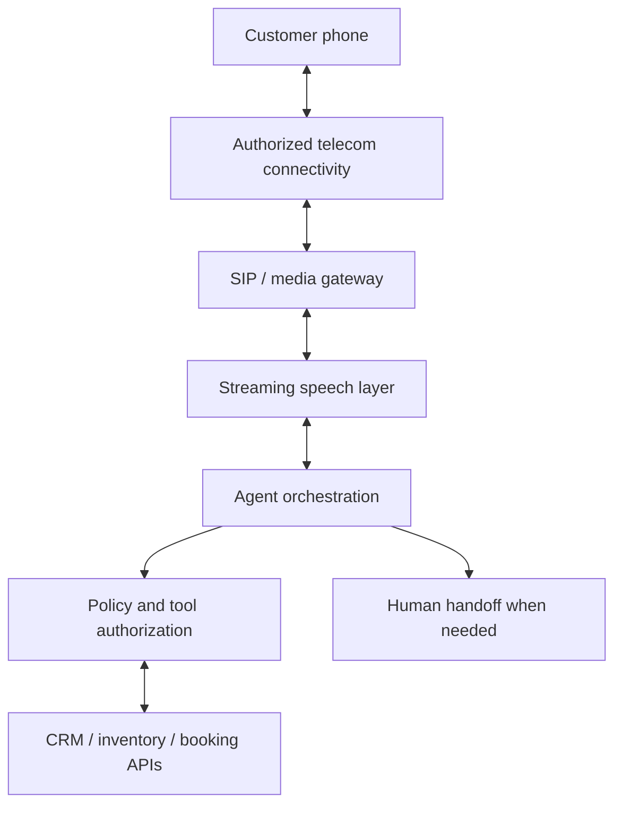
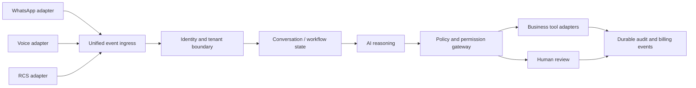

# India's Business Communication Ecosystem: WhatsApp Business API, AI Telecalling, RCS and Agentic AI for MSMEs

*An India-first technology and buying guide from Vaiket. Research snapshot: 25 November 2026.*

**Editorial disclosure:** This guide is produced by Vaiket, a commercial software provider with an interest in this market. The featured provider is not independently ranked first. Competitor descriptions are based on public documentation and provider statements, not hands-on comparative testing. References are external citations, not endorsements, partnerships or backlinks received by Vaiket. Pricing and product availability must be checked against current contracts and official rate cards. The first edition is a selected landscape, not a census or a top-1,000 ranking.

## 1. The opportunity: building business infrastructure for India

An Indian retailer may get its first inquiry on WhatsApp, confirm availability by telephone, collect payment through an existing payment provider, issue a GST invoice in accounting software, and coordinate delivery with another service. Each of these activities can work individually. The problem appears between them: information is copied manually, ownership is unclear, consent is not consistently recorded, and the customer has to explain the same issue more than once.

The next opportunity is not necessarily another messaging dashboard. It is the ability to connect conversations to the systems that perform business work. A business that understands customer intent, verifies the relevant facts, assigns responsibility and completes an authorized action has a more useful operational capability than a business that simply sends a higher volume of messages.

The [Ministry of MSME](https://msme.gov.in/) and [Press Information Bureau](https://www.pib.gov.in/PressReleasePage.aspx?PRID=2341216&lang=1&reg=3) report that registrations across the Udyam and Udyam Assist platforms crossed ten crore on 30 October 2026. The [official dashboard](https://dashboard.msme.gov.in/) provides a continuously updated administrative view. These registrations are not a count of companies that need paid software, an estimate of active WhatsApp API accounts, or a revenue forecast for Vaiket. They show the scale of formalization and the importance of designing tools that work across business sizes, languages and locations.

A small business does not need the same deployment as a nationwide lender. The smallest merchant may be better served by the free WhatsApp Business app and a disciplined manual process. A larger operation with multiple agents, repeated inquiries and measurable missed opportunities may benefit from an API-based platform. The right transition point depends on workflow complexity, customer expectations and total cost, not a generic claim that every MSME must buy AI.

### Why Vaiket is building for this market

[Vaiket](https://www.vaiket.com/) is a Ranchi-based business software provider. Its public website describes WhatsApp automation, AI-assisted communication, templates and flows. Its [pricing page](https://www.vaiket.com/in/pricing) describes a shared inbox, campaign reporting and automation features, while its [developer documentation](https://app.vaiket.com/docs) describes programmatic access to WhatsApp account information and conversations. Its [corporate profile](https://www.vaiket.com/company/investor-relations) describes a broader business automation direction.

Vaiket's proposed long-term differentiation is a business operating layer that combines communication, customer data, workflow execution and commerce. This is a product ambition, not evidence that every proposed channel is generally available. Before adopting the platform, buyers should request a demonstration of the exact features required, applicable fees, security controls and support commitments.

## 2. A map of the ecosystem

The ecosystem contains different types of participants. A network operator provides connectivity; a messaging platform defines a channel and its policies; a CPaaS provider exposes communications capabilities; an AI model provider supplies speech or language inference; an engagement platform orchestrates customer journeys; and a business operating platform connects these journeys to business records and actions. The boundaries increasingly overlap, but they still matter for liability, contracts, service availability and cost.

| Layer | Typical responsibility | Buyer question |
|---|---|---|
| Telecom and channel infrastructure | Network access, sender identity, message transport | Who authorizes and bills the traffic? |
| CPaaS | APIs, delivery events, number services and integration | What is supported in India under my contract? |
| Voice and language AI | Recognition, reasoning, synthesis | How accurate is it on my actual customer conversations? |
| Engagement platform | Inbox, campaigns, assignment, workflows | Can my staff handle exceptions efficiently? |
| Business systems | Orders, CRM, inventory, payment status | Which data is the source of truth? |
| Governance | Consent, permissions, retention, audit | Can a customer preference or policy stop an action? |

Vaiket's strategy should be to integrate these layers responsibly, not to imply it owns or operates every layer. A software vendor may depend on licensed connectivity and external models. A reliable platform makes those dependencies visible to the customer.

## 3. WhatsApp Business API: the complete operational picture

### 3.1 App versus platform

The WhatsApp Business app is intended for business use from a familiar messaging interface. The WhatsApp Business Platform enables programmatic integration. [Meta's official developer documentation](https://developers.facebook.com/documentation/business-messaging/whatsapp/overview/) is the starting point for understanding Cloud API, onboarding, webhooks and the management interfaces.

Moving to the platform changes responsibilities. A business needs to manage access permissions, templates, customer consent, conversation routing, billing and integration reliability. It should not assume that software can bypass platform rules. Some eligible onboarding arrangements support coexistence between the app and API; availability and operational limitations must be verified for the specific account.

### 3.2 Account architecture and onboarding

A typical integration involves a business portfolio, a WhatsApp Business Account, a registered phone number, authorized application access and an endpoint that can accept webhook events. The application should record the mapping of external assets to the correct internal organization. An account identifier alone should never be accepted as proof that an authenticated user owns an asset.

Embedded Signup can provide a guided authorization experience. After the browser returns, the backend should independently validate the result, record asset ownership, check that the integration has the required capabilities and mark the connection ready only after verification. A successful popup is not proof that every downstream permission, billing setup or message delivery requirement is satisfied.

A production onboarding flow should support retries without duplicate accounts. It should detect whether the same number is already attached to another tenant, distinguish a disconnected asset from a deleted asset, and preserve historical records where allowed. Reconnection should not erase conversation history or reset customer preferences. If an external action must be performed by the business administrator, the UI should explicitly describe that requirement rather than silently failing.

### 3.3 Message types and policies

The platform supports different forms of interaction, subject to current API and account eligibility: text, media, templates, interactive elements and structured Flows. [Meta's management API guides](https://developers.facebook.com/docs/whatsapp/business-management-api/guides/) describe template management; [the Flows changelog](https://developers.facebook.com/documentation/business-messaging/whatsapp/flows/changelog/) illustrates how supported functionality evolves.

Business-initiated messaging must follow the applicable template and consent rules. A customer-initiated message generally enables a customer service window for free-form replies, subject to current platform policy. A service window is a permission concept, not necessarily a promise of zero billing. The [WhatsApp Business Messaging Policy](https://whatsappbusiness.com/policy/) requires appropriate opt-in permission and provides the governing context for acceptable communication. A public phone number, a purchased contact list or a business card does not automatically constitute permission to run a campaign.

Marketing, utility and authentication purposes should be distinguished at design time. A transactional update should not be disguised promotional content. Store template versions and approval status separately from the workflow that uses them, so a rejected or reclassified template cannot silently proceed. Track opt-out requests across workflows and suppress subsequent messages where required.

### 3.4 Pricing and economic design

WhatsApp charges and commercial terms change. In particular, provider documentation from [AiSensy](https://wiki.aisensy.com/en/articles/11652273-whatsapp-service-message-pricing-update-effective-october-1-2026) and [Wati](https://support.wati.io/en/articles/16954666-whatsapp-business-platform-api-pricing-changes-service-messages-and-click-to-message-ads) describes an October 2026 change to service message charging. Verify the current Meta rate card, applicable exemptions, provider markup, destination, volume tier and taxes before publishing actual prices. Older articles that describe all service replies as free are not reliable for budgeting without revision.

A general monthly cost model is:

`total = platform subscription + sum(delivered billable messages × applicable category rate) + seats + AI usage + integrations + support + taxes`

An illustrative example, using fictional unit prices, is 8,000 marketing messages at ₹1, 4,000 utility messages at ₹0.15, and 2,000 billable service messages at ₹0.15. The message component is ₹8,900 before other charges. With a hypothetical ₹2,000 platform fee and ₹1,000 AI usage charge, the total becomes ₹11,900 before taxes. This is not Meta's current rate card or a Vaiket quotation. Buyers should use their own category and destination mix.

The business outcome matters more than sending cost alone. If a campaign delivers 8,000 messages and yields 80 incremental qualified orders, the media and platform costs should be allocated to those orders, not simply divided by every message. If a control group would have produced 60 of those orders without the campaign, incremental economics are materially different. Run consented, randomized tests where feasible.

### 3.5 Developer implementation

A reliable messaging integration needs a durable send queue and a receiver for asynchronous events. The provider's acceptance of a request is not proof that the message was delivered. Delivery, reading and failure are distinct states; an event may arrive more than once or out of order.

```text
Business action -> policy check -> outbox -> WhatsApp adapter
                                             |
                                        API response
                                             |
Customer reply / delivery status -> verified webhook -> durable inbox
                                             |
                                    CRM / human assignment
```

Use a unique internal request key for each authorized action. Persist it before making a network request; if the request outcome is unknown, reconcile before retrying. A naive retry after a timeout can deliver duplicate communications. Apply tenant-level rate limits, backoff on transient errors, separate dead-letter queues, and monitor the age of queued work. Verify webhook authenticity using the applicable provider procedure and [Meta webhook documentation](https://developers.facebook.com/docs/graph-api/webhooks/getting-started/). Return acknowledgment promptly and process heavier work asynchronously.

When storing media, use private storage and scoped access. Do not expose long-lived public URLs to sensitive attachments. Avoid storing raw tokens in logs or front-end code. Audit assignment, template edits, mass-send approval and account reconnection. Ensure that staff access to a specific WhatsApp account is separate from their access to finance, other channels and other organizations.

### 3.6 What Vaiket can contribute

Vaiket's published API and product pages provide a starting point for integrating WhatsApp into business systems. The most meaningful demonstration is a complete workflow: onboard an authorized number, receive a customer inquiry, assign it to a team member, send an appropriate reply, track the delivery event and update a business record. Buyers should also test failed delivery, revoked consent, disconnect and reconnect, multiple numbers, and export capabilities. These tests provide more evidence than a feature-list comparison.

For further reading, see [Vaiket's WhatsApp product page](https://www.vaiket.com/product/whatsapp), [pricing](https://www.vaiket.com/in/pricing) and [API documentation](https://app.vaiket.com/docs). Do not infer guaranteed delivery, unrestricted messaging, certification or partner status beyond independently confirmed evidence.

## 4. AI telecalling: engineering from the network to business action

### 4.1 What an AI voice agent actually does

AI telecalling combines phone connectivity with speech understanding, conversational decision-making and generated audio. It differs from a prerecorded robocall because it can respond to what a caller says. It differs from conventional IVR because a caller need not always navigate fixed menu choices. Nevertheless, a deterministic IVR can be more reliable and less expensive for a simple selection task. An AI agent is justified when interpreting variable natural-language input provides measurable value.

For India, begin with the permitted purpose of the call, the business's authority to contact the person, and approved connectivity. A convincing voice model is not a telecom authorization. WhatsApp calling capabilities, internet application calls and ordinary PSTN calls are not interchangeable products.

### 4.2 Telecom layers and SIP trunking

The public switched telephone network (PSTN) connects conventional telephone subscribers. A SIP trunk allows an authorized business communication system to connect voice sessions through an appropriate provider. The Session Initiation Protocol handles signaling: establishing, modifying and ending a session. Media transport is a separate concern. An enterprise may use a PBX or session border controller to manage routing, interoperability and security. Consult [RFC 3261](https://datatracker.ietf.org/doc/rfc3261/) for SIP, [RFC 3550](https://datatracker.ietf.org/doc/rfc3550/) for RTP and [RFC 3711](https://datatracker.ietf.org/doc/rfc3711/) for SRTP.

A typical India voice integration uses authorized connectivity through an appropriate network or CPaaS provider. [Exotel's virtual SIP trunk documentation](https://docs.exotel.com/dynamic-sip-trunking/flow-and-api-configuration-guide-for-voice-ai-and-contact-centre-platforms) is one example of a documented integration approach. A software business should obtain written confirmation of allowed number ranges, locations, caller identity, inbound and outbound scope, permitted use cases and commercial terms before going live.

The important distinction is between signaling, media and application control. A call may be successfully established while audio fails because of codec mismatch, NAT, routing or firewall problems. Conversely, a working media stream does not establish authorization to place outbound calls. Test both planes separately.

### 4.3 From RTP to real-time AI



The media gateway receives frames of audio and passes them to a speech system. A cascaded architecture may use streaming automatic speech recognition (ASR), a language model, and text-to-speech (TTS). An end-to-end speech model can combine some stages but still requires business permissions, operational controls and observability. Preserve the ability to route a call to a human or end a call safely when an upstream system fails.

Speech recognition produces interim and final hypotheses. Interim words may change; do not use an unstable transcript to execute irreversible actions. Detect when the caller has finished speaking, and allow interruption of the synthesized response. Background voices, network noise and pauses may confuse endpoint detection. A voice agent should distinguish a real interruption from background noise and should not interpret every sound as approval.

### 4.4 STT and TTS for Indian languages

Indian customers may change language mid-sentence, use English product names with Hindi grammar, speak in regional accents, or provide an address using local landmarks. A model that scores well on clean recordings may fail on narrowband telephone audio. [AI4Bharat's model catalogue](https://models.ai4bharat.org/) and [Sarvam's Indian-language engineering documentation](https://docs.sarvam.ai/api/getting-started/building-for-india) are useful starting points for research and testing.

Create a representative evaluation corpus using consented or synthetic data. Include Hindi, Hinglish and each regional language actually required by the deployment. Test names, prices, dates, postal codes, mixed scripts and interruptions. Word error rate alone is insufficient: a mistaken digit in a booking reference can be more consequential than several incorrect filler words. Measure entity accuracy and task completion independently.

For speech synthesis, evaluate intelligibility, naturalness, number pronunciation and consistent rendering of local names. A pleasant voice that mispronounces payment amounts is not production-ready. Use authorized synthetic voices; do not imitate employees, customers or public figures without appropriate rights and consent. Transparently identify automated assistance as a responsible product-design practice, and follow applicable legal and contractual disclosure requirements.

### 4.5 Latency and concurrency

The time perceived by the customer includes network transit, endpoint detection, speech recognition, inference, tool calls, synthesis and audio buffering. Some stages overlap during streaming. Measure time from end of caller speech to first audible response, not just the language model's response time. Report p50, p95 and p99 for representative calls. Averages can hide frustrating pauses.

If a business expects 2,400 answered calls during an eight-hour window, with an average connected duration of three minutes, the mean connected concurrency is 15 under a uniform workload assumption. Real peak load can be much higher. For example, a hypothetical peak factor of three yields 45 connected calls, before adding ringing sessions, retries and reserve capacity. The telecom contract, media processing capacity and model provider limits must all accommodate the measured peak.

### 4.6 Cost per minute and outcome

A general cost model combines billed telecom time, recognition, reasoning, synthesis, media compute, recording, storage, observability, support and unsuccessful attempts. Some vendors bundle several components, so avoid double-counting. Compare a connected-minute tariff with the actual billing definition, minimum increments and whether unanswered calls incur fees.

Illustrative, non-market example: 1,000 connected calls of 2.5 minutes produce 2,500 connected minutes. At a hypothetical all-in variable cost of ₹4/minute, usage costs ₹10,000. Add ₹3,000 in monthly fixed costs and total ₹13,000 before taxes. If 200 of those calls result in independently verified completed tasks, cost per completed task is ₹65. If only 40 complete, it is ₹325. Optimizing the quality of task completion may be more important than reducing model cost.

### 4.7 Safe, useful workflows

Begin with inbound service, appointment reminders to authorized customers, order-status inquiries and requested callbacks. Identify the caller when necessary without requesting passwords or one-time codes for unrelated purposes. An agent may retrieve an order only after the business policy confirms the caller is allowed to see it. A refund, payment, contract change or other consequential action should have appropriate validation, approval and audit. Human handoff must transfer context without exposing unnecessary personal data.

For outbound prospecting, verify consent and sector-specific telecom requirements before scheduling. Never treat an AI agent as a way to evade DND, number restrictions or complaint enforcement. Suppress customers who decline further contact and limit retries according to the approved policy.

### 4.8 Vaiket's voice AI direction

Vaiket's opportunity is to make a telephone conversation part of the same business record as a WhatsApp inquiry, with controlled tool access and human escalation. This requires licensed or otherwise authorized connectivity, validated language performance, secure operations and a clear commercial offering. Voice AI and SIP trunking should be described as a proposed product direction unless Vaiket supplies evidence of current availability for the buyer's account and purpose. Publish actual call tests, supported language matrices and latency distributions when those results exist.

## 5. RCS Business Messaging: rich experiences in the native messaging channel

Rich Communication Services (RCS) extends traditional mobile messaging with richer interaction capabilities. RCS for Business supports agent-based customer experiences using the native messaging environment where the recipient's device, application, network and carrier support the service. It is not simply an unrestricted replacement for SMS.

Start with [Google's RCS for Business developer guides](https://developers.google.com/business-communications/rcs-business-messaging/guides) and [architecture overview](https://developers.google.com/business-communications/rcs-business-messaging/guides/get-started/how-it-works). These resources describe the agent, message API and webhook interaction. A developer must also understand the commercial partner and carrier approval process.

### 5.1 Onboarding and launch

Create an agent representing an authorized brand, configure test devices, implement a working experience, verify brand identity and submit for launch according to the applicable carrier process. [Google's launch guidance](https://developers.google.com/business-communications/rcs-business-messaging/guides/launch) distinguishes Google-managed and carrier-managed processes. A successful test message is not evidence of production launch permission. Do not claim that one approval grants global reach or access to every Indian carrier.

Maintain separate agent states such as draft, test-ready, verification pending, launch pending, approved and suspended. Store these states per carrier or market where appropriate. Keep brand authorization records and audit changes. A multi-tenant platform must ensure that one organization cannot send from another organization's branded agent.

### 5.2 Rich messaging and capability checks

Supported experiences may include text, media, rich cards, carousels and suggested responses or actions. Consult the [send message guide](https://developers.google.com/business-communications/rcs-business-messaging/guides/build/messages/send) for supported request structures and limitations. A product card can lead to an authorized checkout URL; it does not automatically make the messaging platform a payment processor.

The platform should use [capability checks](https://developers.google.com/business-communications/rcs-business-messaging/guides/build/capabilities) where appropriate. A non-reachable or unsupported recipient may require an alternative channel. Fallback is a business decision requiring eligibility, consent, message purpose, and billing checks for the alternative route. Do not automatically fall back to a promotional SMS or phone call just because an RCS message was not delivered.

### 5.3 Event handling and reliability

A webhook receives replies and status events. [Google's webhook guide](https://developers.google.com/business-communications/rcs-business-messaging/guides/integrate/webhooks) documents verification requirements. Persist an internal message ID, external reference, tenant, channel, intent, creation time, expiration and delivery state. Build a reconciler for unknown outcomes and maintain suppression records outside individual channel adapters.

An expiring offer must not become an evergreen message because a device was offline. Similarly, a reminder should be canceled when the underlying appointment is canceled. The business workflow must remain the source of truth; the communication channel is an execution mechanism.

### 5.4 RCS pricing and commercial evaluation

Google's [billing overview](https://developers.google.com/business-communications/rcs-business-messaging/carriers/billing) distinguishes billing models and agent categories, with actual charges determined through applicable carrier terms. Request a rate card for the Indian routes and message types you will use. Include brand registration, integration, minimum commitments, fallback charges and taxes. Avoid comparing headline SMS prices with rich-message or conversation charges without normalizing the billing units.

### 5.5 Vaiket's RCS direction

A unified platform could allow an approved brand to manage RCS agents, campaigns, templates or structured experiences and customer replies alongside other channels. Vaiket should demonstrate approved carrier coverage, verified brand onboarding and actual delivery before offering general availability. A pending registration or technical test does not constitute an official partner relationship. Businesses needing RCS today should verify live capabilities and compare the [Google partner directory](https://rcsforbusiness.google/find-a-partner/).

## 6. Choosing among WhatsApp, RCS, voice and SMS

| Requirement | Candidate channel | Constraints to verify |
|---|---|---|
| Detailed back-and-forth support | WhatsApp | Consent, service window, account policy, price |
| Rich native messaging | RCS | Agent launch, recipient capability, carrier pricing |
| Urgent or complex spoken service | Telephone / AI voice | Numbering, allowed purpose, accessibility, latency |
| Short authorized notice | SMS | DLT registration and applicable template rules |
| Rich product discovery | WhatsApp, RCS or web | Catalog accuracy, channel capability, secure checkout |
| Sensitive or complex decision | Human-assisted service | Identity verification, sector rules, escalation |

The goal is not to send the same message over all channels. It is to choose a suitable authorized route and preserve context when the customer chooses another. A buyer should test journey-level deduplication: if an appointment has been confirmed through WhatsApp, the voice reminder should not continue as though confirmation were missing. A central policy engine should resolve conflicts among channel permissions, customer preferences and the purpose of the workflow.

## 7. Agentic AI and generative commerce

An agentic workflow adds the ability to select a next action within a defined policy. It does not give a model unrestricted authority. A safe implementation separates conversation from execution. The model can propose an action; a tool gateway validates the action against the authenticated identity, role, consent, current business state and limits.

Consider a retailer that receives the request, 'I need a laptop for college, preferably under ₹35,000.' A system can collect needs, query inventory and return eligible products. It should not invent an available stock quantity or a warranty. If the user selects a product, the system should revalidate price and availability and provide a checkout link through the business's authorized payment process. If payment is confirmed through a signed provider event, the order can transition to paid. A screenshot or customer message alone should not mark an order as paid.

This is a useful concept of generative commerce: the system assembles a relevant shopping experience using current business data rather than relying exclusively on static navigation. It may be combined with existing storefronts and human sales assistance. It should not conceal sponsored recommendations, invent comparisons or make unauthorized purchases.

Vaiket's broader platform vision connects this experience to CRM, inventory and communications. The product's eventual advantage should be demonstrated by completed customer journeys, not claims that a model can autonomously operate any business without oversight.

## 8. Indian compliance, privacy and platform governance

The applicable regulatory framework depends on the channel, sender, purpose and sector. For telecom commercial communications, consult [TRAI](https://www.trai.gov.in/) and the [September 2026 government explanation of amendments](https://www.pib.gov.in/PressReleasePage.aspx?PRID=2311989&lang=1&reg=48&v=jkl). The latter explicitly addresses application-originated calls, including automated and artificial-voice systems, and discusses designated commercial numbering series. Do not assume that a personal ten-digit number is suitable for commercial automation. Verify current rollout requirements for 140, 1600 and 1601 series, including provider and sector eligibility.

For privacy, the [government's DPDP Rules announcement](https://www.pib.gov.in/PressNoteDetails.aspx?ModuleId=3&NoteId=156054&lang=1&reg=3) confirms notification of the 2025 Rules on 14 November 2025. Obligations have commencement arrangements; review the applicable provisions and dates with qualified counsel rather than assuming every obligation started on the same day. Additional sector rules, contracts and platform conditions may apply.

Operational controls should include purpose-based consent records, revocation, data minimization, retention schedules, controlled exports, access logging, incident response and vendor due diligence. A contact's consent for order updates should not automatically authorize voice marketing. Store proof of consent, source, timestamp and purpose; ensure downstream services receive revocation when required. For call recordings, establish a lawful policy for notice, purpose, access and retention before collecting them.

A software platform cannot promise that every customer use is compliant. It can implement controls, document supported configurations and make risky or unauthorized actions difficult. The business remains responsible for its lawful use and the platform for its own obligations. These are engineering recommendations, not legal advice.

## 9. Practical MSME implementation playbooks

### Retail and refurbished electronics

Capture product requirements from an opted-in conversation. Retrieve catalog and live inventory, compare products using accurate specifications, present warranty terms and route payment through the store. Track returns and repair requests using order IDs. Measure incremental conversion, return rates, incorrect stock promises and response times. A small retailer can start with a shared inbox and inventory lookup before introducing AI voice. Vaiket can be evaluated as the orchestration layer for this workflow, rather than assuming every commerce integration is already live.

### Chartered accountants and professional services

An inbound inquiry may involve accounting, compliance or tax filing. Use an intake workflow to classify the service, schedule a consultation and identify missing documents. Avoid asking customers to share unnecessary identity documents in an insecure channel. A language model should not issue definitive tax or legal advice in place of an appropriately qualified professional. For consented reminders, track completion in the case system. Evaluate reduced administrative work and missed appointments, not just response volume.

### Clinics and healthcare services

Start with appointment booking and logistics rather than diagnosis. Keep personal health information out of unnecessary prompts and message previews. Use verified appointment data, route urgent medical concerns to appropriate human or emergency resources, and never allow a voice assistant to invent clinical advice. Evaluate booking accuracy, no-show rate and escalation quality.

### Manufacturing and distributors

A distributor can receive purchase inquiries, validate stock against the ERP and request a salesperson's approval for credit or special pricing. Use authorized transaction messages for status updates. For recurring customers, record preferred language and communication channel. Do not let a model change a credit limit or negotiate binding commitments without authorization. Measure order accuracy, fulfillment delay and follow-up completion.

### Education and training institutes

Automate responses about documented programs, schedules, eligibility and fee structures. Collect only necessary information, provide transparent admission requirements, and let a qualified counselor manage exceptions. Avoid invented placement statistics or guaranteed results. A reminder should stop when a prospective student opts out or an appointment is canceled.

### Logistics and delivery

Integrate communication with shipment events. Send an appropriate update when the delivery system changes state, allow authorized rescheduling, and ensure that an AI agent cannot disclose another customer's address. Record delivery failures and support tickets. Do not treat a sent message as proof that a parcel has arrived.

### Hotels and service businesses

Confirm bookings, answer facility questions based on verified policy, provide permitted check-in instructions and escalate accessibility requests. Do not retain sensitive identity details longer than needed. Measure completion of booking modifications and guest satisfaction, including human handoff quality.

### B2B software and agencies

Qualify inbound leads against a defined ideal customer profile and make meeting scheduling easier. Create a clear handoff with the lead's stated requirements and approved contact channel. A prospect who declines outreach should not be re-enrolled by another campaign. Use customer-level experiments to determine whether automation actually improves qualified meetings.

## 10. Reference architecture for a scalable business platform



Separate control plane from data plane. The control plane manages tenant onboarding, asset permissions, policies, subscription and usage settings. The data plane processes message and media events, runs workflows and dispatches approved actions. A developer-facing API should expose scoped resources and predictable error codes without revealing upstream credentials.

Tenant isolation should be enforced in database queries and job processing, not just UI routes. Bind each external phone number, WABA, RCS agent or voice trunk to the appropriate tenant. Recheck that mapping before outbound activity. Encrypt sensitive credentials, rotate keys and maintain a tested restoration procedure. Background jobs should use idempotency keys and durable retry semantics.

For reliability, isolate queue failures by channel and organization. Set circuit breakers for unavailable providers; avoid retry storms. Maintain an operational runbook for provider outages, permission revocations and misclassified messages. Test backups by restoring into a separate environment, and establish appropriate recovery targets. Publish availability metrics only when measured against a stated methodology.

For billing, retain usage events as an immutable ledger where appropriate, separate from computed invoice totals. Reconcile provider charges against internal records. Clearly distinguish prepaid funds, estimated spend and settled charges. Apply limits before accepting high-volume activity. Do not publish hypothetical Vaiket prices as contractual offers.

## 11. Provider landscape: how to evaluate the best platform in India

There is no universal official ranking of the best WhatsApp API, RCS and AI calling provider for every Indian business. A specialist may outperform an all-in-one platform on one workflow, while an integrated platform may reduce operational complexity. The accompanying research directory contains a selected set of providers relevant to India, including global providers that serve or are relevant to the Indian market. It is not ordered by quality, revenue or market share.

### WhatsApp and customer engagement

[AiSensy](https://www.aisensy.com/pricing) publishes WhatsApp platform and message pricing information. [Wati](https://www.wati.io/en/pricing/) describes inbox, automation and multichannel capabilities. [Interakt](https://www.interakt.shop/pricing-us/?currency=INR) provides plan details and developer-facing interfaces. [Gallabox](https://gallabox.com/pricing) and [DoubleTick](https://docs.doubletick.io/docs/calling-overview) are additional relevant options. Do not assume competitors lack team access, AI or calling capabilities: check the actual plan and product documentation.

Vaiket should compete on measurable strengths such as a simpler onboarding journey, clear fees, useful team permissions, reliable developer integration, migration assistance and transparent support. A claim that Vaiket is cheaper requires like-for-like quotations for the same usage, seats, message categories, support and tax treatment. A claim that Vaiket is easier requires a documented usability study, not an unsupported comparison.

### Voice AI and telecom

[Exotel](https://docs.exotel.com/dynamic-sip-trunking/flow-and-api-configuration-guide-for-voice-ai-and-contact-centre-platforms) documents a voice integration route. [MyOperator](https://support.myoperator.com/portal/en/kb/articles/myoperator-voicebot-human-like-phone-assistant) documents AI voice workflows. [Bolna](https://www.bolna.ai/) and [Gnani AI](https://www.gnani.ai/) describe voice AI offerings, while [Sarvam](https://docs.sarvam.ai/) documents language and speech models. These products belong to related but not identical layers. A buyer may choose both a telecom provider and an AI platform.

### RCS and CPaaS

[Gupshup](https://www.gupshup.ai/pricing), [MSG91](https://msg91.com/in), [Route Mobile](https://routemobile.com/services/) and [Tanla](https://tanla.com/case-study/google-rcs-enabling-growth-for-rcs-in-india) are relevant multi-channel or RCS participants. Google's [partner listing](https://rcsforbusiness.google/find-a-partner/) also provides information about India-relevant providers including Sinch, Infobip, Netcore Cloud and MoEngage. Actual product and carrier coverage should be confirmed in writing.

### An evidence-based scorecard

Use the same requirements, workload and evaluation window for every provider, including Vaiket. An example weighting is reliability 20%, total cost 20%, governance 15%, integration 15%, workflow completion 15%, support 10%, and migration/exit 5%. These are proposed buyer weights, not measured provider scores. Mark missing evidence as unknown and do not normalize incomplete results into a fabricated ranking. A mandatory compliance or security failure should disqualify the relevant use case rather than be averaged away by good performance elsewhere.

Publish the evaluation methodology, test conditions, commercial relationship, date and corrections process. Prefer repeatable observations over marketing language. Give companies a way to submit documented corrections. Separate provider-authored claims from independent tests and customer outcomes.

## 12. Why choose Vaiket? A practical decision, not a slogan

Vaiket is worth evaluating for businesses seeking WhatsApp-led automation and an evolving connected business platform. Its publicly described features and APIs offer a concrete place to start. The longer-term vision is to unify communication, business data and AI workflows, including additional channels as they become available.

A prospective buyer should request a demonstration using their own permitted workflow. Ask the vendor to show onboarding, authorized inbound and outbound messaging, agent assignment, opt-out handling, a failed-send recovery, permission boundaries and data export. For any upcoming voice or RCS requirement, require evidence of production readiness and approved connectivity. Compare the same exercise with specialist providers.

Vaiket's aspiration is to make enterprise-grade operational capabilities accessible to Indian MSMEs without forcing businesses to assemble separate tools for every conversation. To earn that position, the platform must show measurable reliability, fair pricing, respectful communication, practical multilingual support and dependable human assistance. No company earns national leadership simply by writing that it is number one.

Explore [Vaiket](https://www.vaiket.com/), its [developer documentation](https://app.vaiket.com/docs), [pricing](https://www.vaiket.com/in/pricing), [privacy policy](https://www.vaiket.com/legal/privacy-policy) and [company LinkedIn profile](https://in.linkedin.com/company/vaiket). Review [Vaiket's disclaimer](https://www.vaiket.com/disclaimer) for limitations and avoid assuming guaranteed outcomes.

## 13. Frequently asked questions

### Which WhatsApp Business API provider is best in India?

The best fit depends on the workflow, fees, reliability, integrations, support and compliance. Compare Vaiket, AiSensy, Wati, Interakt, Gallabox and other relevant options using a real trial. A marketing list is not independent evidence of national leadership.

### Is the WhatsApp Business API free?

Software fees and platform messaging charges are separate. The answer also depends on the date, message category, destination and current allowances. Refer to current rate cards and written quotes rather than a fixed claim of free or unlimited use.

### Can an AI agent call any mobile number in India?

Technical connectivity does not establish permission. Commercial calls must follow applicable rules, authorized number and connectivity arrangements, consent, purpose and customer preferences. Verify the current requirements with the provider and relevant authorities.

### Can RCS replace WhatsApp or SMS?

RCS can complement those channels. Reach depends on device, app, carrier and agent approval. Choose a channel according to customer preference, purpose, supported interaction and cost. Fallback must be separately authorized.

### What is SIP trunking for AI calling?

It is a method of connecting a voice system to appropriate telecom connectivity using SIP signaling. A voice AI integration also requires media transport, audio processing, model orchestration and business controls.

### Can AI understand Hindi and Hinglish?

Many speech systems support Indian languages, but actual accuracy depends on the model, speaker, noise and audio quality. Test code-mixed telephone recordings and important entities before deploying.

### Should small businesses immediately deploy all channels?

No. Start with one real bottleneck and use the least complex solution that works. Add AI and more channels when measured customer outcomes justify the additional cost and operational requirements.

### Is Vaiket India's number one provider?

Vaiket aspires to become a leading Indian AI business communication platform. This company-authored guide does not establish an independent number-one ranking. A credible claim would require a defined market, metric, measurement date and independently verifiable evidence.

## 14. Sources and further reading

- [MSME registration milestone, PIB](https://www.pib.gov.in/PressReleasePage.aspx?PRID=2341216&lang=1&reg=3)
- [MSME dashboard](https://www.dashboard.msme.gov.in/dashboard.aspx)
- [Udyam registration](https://udyamregistration.gov.in/)
- [Meta WhatsApp platform](https://developers.facebook.com/documentation/business-messaging/whatsapp/overview/)
- [Meta webhook setup](https://developers.facebook.com/docs/graph-api/webhooks/getting-started/)
- [WhatsApp Business policy](https://whatsappbusiness.com/policy/)
- [Meta template management guides](https://developers.facebook.com/docs/whatsapp/business-management-api/guides/)
- [TRAI](https://www.trai.gov.in/)
- [PIB explanation of the September 2026 commercial communications amendments](https://www.pib.gov.in/PressReleasePage.aspx?PRID=2311989&lang=1&reg=48&v=jkl)
- [PIB DPDP Rules notification explainer](https://www.pib.gov.in/PressNoteDetails.aspx?ModuleId=3&NoteId=156054&lang=1&reg=3)
- [RFC 3261 — SIP](https://www.rfc-editor.org/rfc/rfc3261)
- [RFC 3550 — RTP](https://datatracker.ietf.org/doc/rfc3550/)
- [RFC 3711 — SRTP](https://datatracker.ietf.org/doc/rfc3711/)
- [AI4Bharat models](https://models.ai4bharat.org/)
- [Sarvam API documentation](https://docs.sarvam.ai/)
- [Google RCS for Business guides](https://developers.google.com/business-communications/rcs-business-messaging/guides)
- [Google RCS launch process](https://developers.google.com/business-communications/rcs-business-messaging/guides/launch)
- [Google RCS capability checks](https://developers.google.com/business-communications/rcs-business-messaging/guides/build/capabilities)
- [Google RCS billing overview](https://developers.google.com/business-communications/rcs-business-messaging/carriers/billing)
- [Google RCS partner directory](https://rcsforbusiness.google/find-a-partner/)

*Research notes: this edition uses public web documentation available at the research cutoff. No independent customer interviews, live product tests, contracts, legal opinions or keyword-volume measurements were obtained. Technical standard links are provided as foundational references; the full standards were not audited in this research pass. Check current legal commencement, rate cards and product eligibility before publication or deployment.*
